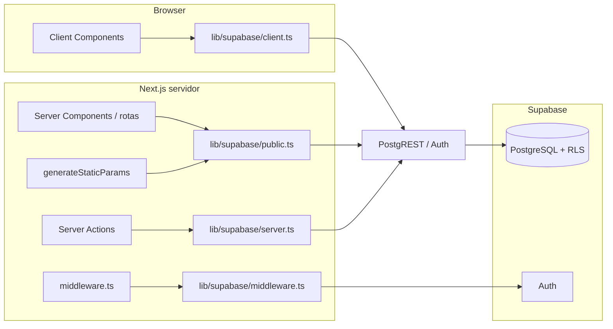

# Estrutura do Projeto

## Visão geral da arquitetura

Via Fidei é um app **Next.js 15 (App Router)** com dados em **Supabase** (PostgreSQL + Auth + RLS). Não há backend próprio fora do que o Next expõe (Server Components, Server Actions) e a API REST do Supabase.



- **Páginas públicas** (home, `/igreja/[slug]`, `/clero`): leitura via **`createPublicClient()`** — sem `cookies()`, compatível com build estático e RLS como role `anon`.
- **Área autenticada** (`/login`, `/admin`, Server Actions): **`createServerClient()`** com cookies — JWT do usuário nas políticas RLS.
- **Interação no cliente** (AuthProvider, formulários admin que usam cliente): **`createBrowserClient()`** — mesma URL e chave pública do projeto.

---

## Stack e dados (Supabase)

Resumo do que está em produção hoje:

| Camada | Descrição |
|--------|-----------|
| **Banco** | PostgreSQL no Supabase; schema versionado em [`supabase/migrations/`](../../supabase/migrations/) (`001`–`018`). Aplicar em ordem no **SQL Editor** do projeto (ou `supabase db push` com CLI linkado). As migrations `001`–`009` foram aplicadas pelo SQL Editor e não aparecem no histórico de migrations do projeto remoto (só a `010`, aplicada via MCP); as `011`–`013` foram conferidas pelo schema em 30/10/2026; a `014` foi aplicada e conferida com o roteiro `supabase/tests/014_rls_permissoes_editor_verificacao.sql` em 31/10/2026; as `015`–`018` foram aplicadas e conferidas com os roteiros de `supabase/tests/` (a `017` e a `018` em 04/11/2026) — conferir o estado pelo schema, não por `supabase migration list`. |
| **Chaves públicas** | URL + chave **publishable** ou **anon** (JWT) para o cliente. Resolução central em [`lib/supabase/env.ts`](../../lib/supabase/env.ts) — ver subseção **Variáveis de ambiente (Supabase + Vercel)** abaixo. `SUPABASE_SERVICE_ROLE_KEY` **apenas** servidor / `npm run seed` ([API keys](https://supabase.com/docs/guides/api/api-keys)). |
| **Auth** | Supabase Auth + cookies (`@supabase/ssr`); [`middleware.ts`](../../middleware.ts) na raiz renova a sessão; [`features/auth/`](../../features/auth/) expõe `AuthProvider` e `useAuth`. |
| **Leitura pública** | [`lib/supabase/public.ts`](../../lib/supabase/public.ts) — `createClient` do `@supabase/supabase-js` só com chave pública, **sem** `cookies()`. Usado em [`lib/supabase/queries/`](../../lib/supabase/queries/) (listagens, detalhes, `generateStaticParams`). |
| **Sessão no servidor** | [`lib/supabase/server.ts`](../../lib/supabase/server.ts) — `createServerClient` com cookies (login, `/admin`, Server Actions). |
| **Cliente browser** | [`lib/supabase/client.ts`](../../lib/supabase/client.ts) — `createBrowserClient` (`@supabase/ssr`). |
| **Middleware** | [`lib/supabase/middleware.ts`](../../lib/supabase/middleware.ts) — usado pelo [`middleware.ts`](../../middleware.ts) na raiz (refresh de sessão). |
| **Service role** | [`lib/supabase/service-role.ts`](../../lib/supabase/service-role.ts) — `createServiceRoleClient()` (sem sessão persistida), **somente servidor** (`server-only` quebra o build se for importado no cliente). Usado pela Server Action `createEditor` para a Auth Admin API (`auth.admin.createUser`), que não aceita a chave pública. |
| **Seed** | [`scripts/seed.ts`](../../scripts/seed.ts) + [`scripts/load-env.ts`](../../scripts/load-env.ts) — `npm run seed` popula o banco a partir de `data/*.ts` (requer `SUPABASE_SERVICE_ROLE_KEY` + URL resolvível por `getSupabaseUrl()`). |
| **Bootstrap de usuários** | [`scripts/bootstrap-users.ts`](../../scripts/bootstrap-users.ts) — `npm run bootstrap-users` cria (ou reaproveita) um admin e um editor de teste no Auth, ajusta `profiles.role`, ativa os perfis (`is_active = true`, já que o perfil nasce inativo desde a `015`) e vincula o editor a uma igreja em `editor_churches`. Variáveis `ADMIN_*` / `EDITOR_*` documentadas em [`.env.example`](../../.env.example). |
| **Dados em TS** | Arquivos em [`data/`](../../data/) não são importados pelas páginas; servem de fonte para o seed e referência. |

**ISR:** `export const revalidate = 60` nas páginas que listam dados do Supabase.

### Variáveis de ambiente (Supabase + Vercel)

O Next.js só injeta no **bundle do browser** variáveis com prefixo `NEXT_PUBLIC_*`. A **integração oficial Vercel ↔ Supabase** costuma criar também `SUPABASE_URL`, `SUPABASE_ANON_KEY`, `SUPABASE_PUBLISHABLE_KEY` (sem esse prefixo).

| Necessidade | Variáveis aceitas (ordem de preferência) |
|-------------|------------------------------------------|
| URL do projeto | `NEXT_PUBLIC_SUPABASE_URL` → fallback `SUPABASE_URL` |
| Chave pública (API) | `NEXT_PUBLIC_SUPABASE_PUBLISHABLE_KEY` → `NEXT_PUBLIC_SUPABASE_ANON_KEY` → `SUPABASE_PUBLISHABLE_KEY` → `SUPABASE_ANON_KEY` |
| Privilegiada (seed, bootstrap, Auth Admin API, bypass RLS) | `SUPABASE_SERVICE_ROLE_KEY` (nunca `NEXT_PUBLIC_`). Necessária também em runtime no servidor para criar editores pelo painel `/admin/usuarios/novo`. |
| Bootstrap de usuários (opcional, só local) | `ADMIN_EMAIL`, `ADMIN_PASSWORD`, `EDITOR_EMAIL`, `EDITOR_PASSWORD`, `ADMIN_NAME`, `EDITOR_NAME`, `EDITOR_CHURCH_ID` |

[`next.config.ts`](../../next.config.ts) espelha no build os valores `SUPABASE_*` para `NEXT_PUBLIC_*` quando só a integração preenche os nomes sem prefixo — assim **`createBrowserClient`** e o restante do código continuam funcionando no cliente.

**Deploy na Vercel:** marque as variáveis para **Production** e **Preview** (deploys de PR). Se estiverem só em Production, o build de Preview falha por ausência de URL/chave no ambiente.

**Local:** copie [`.env.example`](../../.env.example) para `.env.local`. O `.env.local` não é enviado ao Git; na Vercel as variáveis vêm do painel ou da integração.

**Testes (`.env.test`, VF-098):** o `.env.test` aponta só para o Supabase local (`http://127.0.0.1:54321`) e **não é versionado** — o `.gitignore` cobre `.env.test*`, e a regra "nunca commitar `.env*`" vale sem exceção. Cada máquina gera o seu com `npm run test:db:env` (ver **Testes contra o Supabase local**). Chave de projeto real nunca entra nele. E se o arquivo apontar para um projeto real, `tests/db/env.ts` recusa o **host** antes de qualquer cliente existir, então nada é gravado — a validação é da URL, não da chave. Variável nova no `.env.test` precisa entrar também na lista de `tests/setup/env.ts`, porque o Vitest carrega o arquivo em `process.env` no modo `test`. O Next só carrega `.env.test` com `NODE_ENV=test`, então `next build`, `next start` e o e2e continuam usando o `.env.local`; o projeto Vitest `db` lê o arquivo direto do disco (ver **Testes contra o Supabase local**).

### Integração com o código

| Arquivo | Papel |
|---------|--------|
| [`lib/supabase/env.ts`](../../lib/supabase/env.ts) | `getSupabaseUrl()`, `getSupabasePublishableKey()`, `getSupabaseServiceRoleKey()`, `isSupabasePublicConfigured()` |
| [`lib/supabase/public.ts`](../../lib/supabase/public.ts) | Cliente anônimo para queries públicas (sem sessão) |
| [`lib/supabase/server.ts`](../../lib/supabase/server.ts) | Cliente com cookies (sessão) |
| [`lib/supabase/client.ts`](../../lib/supabase/client.ts) | Cliente no browser |
| [`lib/supabase/service-role.ts`](../../lib/supabase/service-role.ts) | Cliente privilegiado (service role) — só servidor |
| [`lib/supabase/queries/churches.ts`](../../lib/supabase/queries/churches.ts) | `getChurches`, `getChurchBySlug` (consulta aninhada única, com `cache()` do React), `getChurchSlugs`; `toChurch` mapeia a linha de `churches` para as duas primeiras |
| [`lib/supabase/queries/clergy.ts`](../../lib/supabase/queries/clergy.ts) | `getAllClergyWithChurch` |
| [`supabase/migrations/*.sql`](../../supabase/migrations/) | Schema + RLS (`008_rls_policies.sql`) |

---

## Organização por Feature

O projeto segue uma arquitetura organizada por **features/domínios**, não por tipo de arquivo.

### Raiz do repositório

- [`middleware.ts`](../../middleware.ts) — integração `@supabase/ssr` para refresh de sessão (matcher exclui assets estáticos)

### `/app` - App Router (Next.js)

Contém rotas, layouts e páginas da aplicação.

- `layout.tsx` - Layout raiz com metadados, fontes, AuthProvider e o script inline de tema (`THEME_INIT_SCRIPT` de `features/theme`)
- `icon.png` (32 px) e `apple-icon.png` (180 px) - Favicon e ícone Apple pela convenção de arquivos do App Router (VF-090); o Next gera os `<link rel="icon">` e `<link rel="apple-touch-icon">` com hash. Não há `icons` no `metadata`. Gerados a partir do logo, com recorte central no favicon para o pino ficar legível em 16–32 px
- `error.tsx` - Erro de renderização de qualquer rota, dentro do layout raiz (VF-092). Mostra `ErrorFallback` (`components/error-fallback.tsx`): texto para o fiel, sem `error.message`, botão "Tentar novamente" (`router.refresh()` + `reset()` numa transição, para buscar de novo os Server Components) e link para o início; registra só o `digest` no console
- `global-error.tsx` - Erro no próprio layout raiz: desenha `<html>`/`<body>`, importa `globals.css` e aplica o tema salvo com o `THEME_INIT_SCRIPT` no `<head>` (HTML vindo do servidor) e com `applyStoredTheme()` num efeito (renderização no cliente, em que o React não executa `<script>` inline); mesmo `ErrorFallback`, que leva o foco ao título ao montar para o leitor de tela anunciar o erro
- **Onde o `error.tsx` aparece (conferido com o Supabase fora do ar):** rotas dinâmicas (`/admin/*`), erros no cliente e o `next dev`. As páginas públicas são ISR: no Next 15, um erro durante a geração estática (build, revalidação ou primeira visita a um slug fora do `generateStaticParams`) **não** passa pelo `error.tsx`. Na revalidação, a versão em cache continua sendo servida; sem versão em cache (ex.: slug novo), o Next responde 500 com a página genérica `500.html` do pages router. No `next dev`, `/igreja/*` também cai na página genérica, porque o dev roda o `generateStaticParams` a cada requisição
- `admin/loading.tsx` - Carregamento das páginas do admin (spinner com `role="status"`), dentro do `admin/layout.tsx`, na navegação entre as subrotas dinâmicas. Com o streaming, o `notFound()` de `admin/usuarios/[id]` passa a responder 200 (soft 404), aceitável numa área `noindex`
- **Sem `loading.tsx` em `/igreja/[slug]` (decisão do VF-092):** com o `loading.tsx`, a página entra em streaming e o `notFound()` de um slug inexistente responde **200** em vez de 404 (soft 404, ruim para SEO). Conferido pelo e2e "igreja inexistente responde 404". Os slugs conhecidos já são pré-gerados e pré-carregados pelo `<Link>`, então o ganho seria pequeno
- `page.tsx` - Página inicial (listagem de igrejas com busca e filtro)
- `globals.css` - Estilos globais e variáveis CSS do Tailwind
- `igreja/[slug]/page.tsx` - Página de detalhes da igreja (SSR com `generateStaticParams`)
- `igreja/[slug]/not-found.tsx` - Página 404 customizada
- `clero/page.tsx` - Listagem geral de clérigos com filtro alfabético
- `login/page.tsx` - Página de login (rota escondida, sem link na UI)
- `admin/layout.tsx` - Layout admin com verificação de papel (sem sessão → `/login`; não admin → `/`) e `AdminHeader`
- `admin/page.tsx` - Dashboard admin com estatísticas (igrejas, editores, clérigos)
- `admin/usuarios/` - Lista, detalhe (ativar/desativar, vínculos com igrejas) e criação de editores

### `/features` - Features do domínio

Cada feature agrupa componentes, hooks e lógica relacionados.

**`/features/churches`** - Feature de igrejas

- `church-card.tsx` - Card de igreja para listagem
- `church-list.tsx` - Lista de igrejas com busca e filtros (Client Component)
- `use-church-filters.ts` - Hook de busca, filtro por bairro e paginação
- `page-header.tsx` - Header da página inicial
- `pagination.tsx` - Componente de paginação
- `pagination-controls.tsx` - Controles de paginação
- `per-page-filter.tsx` - Filtro de itens por página

**`/features/churches/schedule`** - Horários das igrejas

- `schedule-tabs.tsx` - Componente de abas (Client Component)
- `schedule-day-list.tsx` - Lista de horários por dia em accordion (shadcn/ui Accordion). Cada dia é um item colapsável com contagem de horários; o primeiro dia vem expandido por padrão. **Layout anterior**: lista vertical simples com todos os dias empilhados (`space-y-4`) e badges de horário em `flex-wrap` -- sem colapsável, todo conteúdo visível de uma vez.
- `schedule-empty.tsx` - Estado vazio
- `activity-list.tsx` - Lista de atividades

**`/features/churches/clergy`** - Clero das igrejas

- `clergy-card.tsx` - Card básico de clérigo
- `clergy-card-with-modal.tsx` - Card com modal de detalhes
- `clergy-detail-modal.tsx` - Modal com informações detalhadas do clérigo
- `clergy-list.tsx` - Lista de clérigos ativos da paróquia
- `clergy-history.tsx` - Histórico de clérigos anteriores

**`/features/churches/contact`** - Contato das igrejas

- `church-contact-section.tsx` - Seção de contato (telefone, WhatsApp, redes sociais)

**`/features/churches/ministries`** - Grupos, movimentos e pastorais

- `ministries-section.tsx` - Seção principal com subdivisões por categoria (Grupos, Movimentos, Pastorais)
- `ministry-list.tsx` - Lista de ministérios renderizados como tags/badges

**`/features/clergy`** - Feature de listagem de clérigos (página `/clero`)

- `clergy-page-list.tsx` - Lista com busca e filtro alfabético (Client Component)
- `clergy-list-card.tsx` - Card compacto de clérigo
- `clergy-page-modal.tsx` - Modal com detalhes e link para paróquia
- `clergy-vital-info.tsx` - Nascimento, falecimento e idade (ícones de estrela e cruz; idade só com data completa)
- `clergy-honor-flags.tsx` - Títulos e funções como flags (Cônego, Vigário Geral, Prefeito de Estudos)
- `use-clergy-filters.ts` - Hook de busca e filtro por letra inicial

**`/features/churches/editor`** - Experiência de edição na página de igreja

- `editable-section.tsx` - Wrapper que exibe empty state + botão "Adicionar" para editores vinculados
- `edit-indicator.tsx` - Ícone de lápis exibido condicionalmente para quem pode editar
- `admin-church-link.tsx` - Link para gerenciar editores (visível apenas para admin)

**`/features/auth`** - Autenticação e controle de acesso

- `auth-provider.tsx` - Provider com estado do usuário, papel e igrejas vinculadas
- `use-auth.ts` - Hook para acessar contexto de autenticação
- `access.ts` - Regras puras de acesso pelo perfil: destino do login, `canEditChurch`, admin/editor ativo e alvo das ações de admin (só `role = 'editor'`)
- `actions.ts` - Server Actions de login/logout
- `admin-actions.ts` - Server Actions para gestão de editores (admin)
- `admin-validation.ts` - Schemas zod e funções puras de validação da entrada das actions de admin
- `types.ts` - Tipos (UserRole, UserProfile, AuthContextValue)

**`/features/admin`** - Área administrativa

- `admin-header.tsx` - Header do painel `/admin` (mesmo padrão do header público: logo, navegação com ícones, link ativo destacado e botão de tema). No mobile mostra só os ícones (textos em `sr-only`); a partir de `md` mostra os textos.

**`/features/theme`** - Tema da aplicação

- `theme-provider.tsx` - Provider de tema claro/escuro
- `theme-toggle.tsx` - Botão de alternância de tema
- `theme-script.ts` - `applyStoredTheme()` (tema salvo em `via-fidei-theme` ou, sem ele, o do sistema) e `THEME_INIT_SCRIPT`, o script inline do `<head>` gerado a partir da mesma função (`toString()`), que por isso não pode usar imports nem constantes de fora do corpo

### `/components` - Componentes compartilhados

Componentes reutilizáveis em todo o projeto.

- `footer.tsx` - Rodapé das páginas públicas
- `error-fallback.tsx` - Tela de erro do `app/error.tsx` e do `app/global-error.tsx` (VF-092)

**`/components/ui`** - Componentes do shadcn/ui

- Instalados via `npx shadcn@latest add [component]`
- Customizáveis e prontos para uso

### `/lib` - Bibliotecas e utilitários

Código auxiliar reutilizável.

**`/lib/utils`** - Funções utilitárias

- `cn.ts` - Função para merge de classes Tailwind
- `slugify.ts` - Geração de slugs a partir de nomes
- `schedule.ts` - Utilitários de horários:
  - `formatTime()` - Formata hora ("18:00" → "18h")
  - `formatTimeRange()` - Formata intervalo ("06:30" - "17:30")
  - `getDayName()` / `getDayNameShort()` - Nome do dia em português
  - `groupByDay()` - Agrupa eventos por dia da semana
  - `getOrderedDays()` - Dias ordenados (domingo primeiro)
  - `canGroupWeekdays()` - Verifica se pode agrupar dias úteis
  - `formatRecurrence()` - Label de recorrência ("1ª Sexta-feira do mês")
  - `isValidTime()` - Valida `HH:MM` com dois dígitos (00:00–23:59); mesma regra do CHECK `is_valid_schedule_time()` da `016`
  - `isScheduleTimeOrderValid()` - Término depois do início (`end_time > time`, estrito); mesma regra do CHECK `is_schedule_time_order_valid()` da `018`
  - `validateScheduleTimes()` / `SCHEDULE_TIME_MESSAGES` - Lista de problemas (`{ field, reason }`) e mensagens por motivo, para os formulários (VF-021)
  - `getEventKey()` - Gera chave única para React
- `clergy.ts` - Utilitários de clero:
  - `getRoleLabel()` - Traduz role para português ("Pároco", "Vigário")
  - `getClergyTitle()` - Retorna prefixo ("Pe.", "Mons.", "Fr.", "Dom")
  - `formatClergyName()` - Nome completo formatado ("Pe. José da Silva, OFM")
  - `sortClergyByRole()` - Ordena por hierarquia canônica
  - `isActiveClergyMember()` / `getActiveClergyMembers()` - Filtra clérigos ativos
  - `getPastClergyMembers()` - Filtra clérigos anteriores
  - `formatClergyTenure()` - Período de atuação ("2021 - Atual")
  - `getClergyHonors()` / `getClergyHonorLabel()` - Filtra títulos conhecidos na ordem de exibição e traduz ("Cônego")
  - `isFullClergyDate()` - Verifica se a data é `YYYY-MM-DD` real (ano 0001–9999, bissexto gregoriano)
  - `isValidClergyDate()` - Formato das datas do clero e dos vínculos: `YYYY` ou `YYYY-MM-DD` real; mesma regra do CHECK `is_valid_clergy_date()` da `016`
  - `getClergyYear()` - Ano de uma data (`YYYY` ou `YYYY-MM-DD`)
  - `getClergyAge()` - Idade em anos completos (até o falecimento, se houver); `null` quando só há o ano
  - `sortClergyByStartDate()` - Ordena por data de início
  - `getClergyForChurch()` - Filtra clérigos de uma igreja específica por churchId
  - `getAllClergyWithChurch()` - Enriquece clérigos com dados da igreja (join por churchId)
  - `sortClergyByName()` - Ordena alfabeticamente por nome
  - `getClergyInitials()` - Letras iniciais únicas dos nomes
  - `filterClergyByInitial()` - Filtra por letra inicial (ignora acentos)
- `clergy-dates.ts` - Ordem e "não futura" das datas do clero (VF-105; ver [Formatos e ordem](#formatos-e-ordem-de-horário-e-data-vf-088-vf-105)):
  - `compareClergyDates()` - Compara na menor precisão comum (`YYYY` × `YYYY-MM-DD` compara só o ano)
  - `isClergyDateOrderValid()` - Data posterior ≥ anterior; mesma regra do CHECK `is_clergy_date_order_valid()` da `018`
  - `isClergyDateNotFuture()` - Data ≤ hoje (recebe hoje por parâmetro); mesma regra de `is_clergy_date_not_future()` da `018`
  - `getTodayInMaceio()` - Dia de hoje em `America/Maceio` (`YYYY-MM-DD`)
  - `validateClergyVitalDates()` / `validateClergyTenureDates()` / `CLERGY_DATE_MESSAGES` - Lista de problemas (`{ field, reason }`) e mensagens por motivo, para os formulários (VF-021)
- `contact.ts` - Utilitários de contato:
  - `formatPhoneForDisplay()` - Formata telefone ("(82) 99999-9999")
  - `formatPhoneForHref()` - Telefone para href (apenas dígitos)
  - `formatInstagramHandle()` / `getInstagramUrl()` - Instagram
  - `formatFacebookName()` / `getFacebookUrl()` - Facebook
  - `getWebsiteUrl()` / `formatWebsiteForDisplay()` - Website

**`/lib/security`** - Cabeçalhos HTTP de segurança

- `headers.ts` - `buildSecurityHeaders()` e `buildContentSecurityPolicy()`, puras, usadas pelo `next.config.ts` (ver [Cabeçalhos de segurança](#cabeçalhos-de-segurança-vf-081))

### `/types` - Definições de tipos TypeScript

Tipos e interfaces compartilhados.

- `church.ts` - Tipos principais:
  - `Church` - Interface da igreja
  - `ChurchType` - Tipo de entidade ("parish", "rectory", "cathedral", "chapel", "sanctuary")
  - `ChurchContact` - Informações de contato
  - `ScheduleEvent` - Evento de horário (missa, adoração, confissão)
  - `Activity` - Atividade com horários
  - `DayOfWeek` - Tipo literal (0-6)
  - `RecurrenceType` - Tipos de recorrência
  - `Clergy` - Interface do clérigo
  - `ClergyWithChurch` - Clérigo enriquecido com dados da igreja (para listagens)
  - `ClergyRole` - Cargo ("parish-priest", "vicar", "deacon", "administrator", "rector")
  - `ClergyTitle` - Título ("padre", "monsenhor", "frei", "dom")
  - `ClergyHonor` - Título/função exibido como flag ("canon", "vicar-general", "prefect-of-studies"), independente do cargo
  - `ReligiousOrderSuffix` - Ordem religiosa ("OFM", "SJ", "OP", "OSB", etc.)
  - `ChurchMinistry` - Grupo, movimento ou pastoral (`{ id, label, acronym? }`)
  - `ChurchMinistries` - Ministérios por categoria (`{ groups?, movements?, pastorals? }`)
- `index.ts` - Re-exporta todos os tipos

### `/data` - Dados estáticos (legado)

Arquivos TS mantidos como referência e para o script de seed (`scripts/seed.ts`). **Não são mais importados** pelas páginas da aplicação — os dados vêm do Supabase.

- `churches.ts` - 55 igrejas reais de Maceió/AL (fonte: [Hora da Missa](https://www.horadamissa.com))
- `clergy.ts` - Clérigos como entidades independentes
- `ministries.ts` - Grupos, movimentos e pastorais por categoria

### `/public` - Assets estáticos

Arquivos públicos servidos diretamente.

**`/public/images`** - Imagens (estrutura flat)

- `via-fidei-logo.png` - Logo do cabeçalho (via `next/image`) e imagem padrão das igrejas sem foto (VF-090: 1024 px, PNG com paleta, 8.403 bytes; antes 1.081.277). O nome foi mantido para não quebrar referências (README, código e eventuais `image_url` no banco). O original tinha ruído de ±2 no fundo roxo, que impedia a compressão; a versão leve reconstrói o desenho como mistura exata do roxo `rgb(106, 75, 145)` com o branco, a partir da luminância de cada pixel, mantendo o antisserrilhado. O fundo é opaco, então serve nos dois temas
- Imagens de igrejas e clérigos por slug (ex: `sao-paulo-apostolo.jpg`, `pe-manoel-jose-dos-santos.jpg`)
- Só formatos raster (`.jpg`, `.jpeg`, `.png`). O `next.config.ts` não liga `images.dangerouslyAllowSVG` (desde o VF-080): um `src` `.svg` no `next/image` é servido sem otimização, e o otimizador recusa SVG. Os cabeçalhos do otimizador seguem os padrões do Next (`Content-Disposition: attachment` e CSP com `sandbox` e `script-src 'none'`).

### `/lib/supabase` - Integração com Supabase

Papel de cada arquivo, variáveis e fallbacks da integração Vercel: ver as seções **Stack e dados (Supabase)** e **Integração com o código** no início deste documento.

### `/supabase` - Migrations SQL

Arquivos de migration para criar o schema do banco, ordenados numericamente:

- `001_profiles.sql` - Tabela de perfis (vinculada ao auth.users) + triggers
- `002_churches.sql` - Tabela de igrejas
- `003_schedule_events.sql` - Horários (missas, adorações, confissões)
- `004_activities.sql` - Atividades + horários de atividades
- `005_clergy.sql` - Clérigos + vínculo clérigo-igreja
- `006_ministries.sql` - Ministérios + vínculo ministério-igreja
- `007_editor_churches.sql` - Vínculo editor-igreja
- `008_rls_policies.sql` - Políticas de Row Level Security (ajustadas pela `010` e pela `014`)
- `009_profiles_auth_insert_policies.sql` - Reescreve `handle_new_user()` com `search_path` explícito (corrige "Database error creating new user"); as políticas de INSERT que ela cria foram removidas na `010`
- `010_profiles_privilege_escalation.sql` - Trigger `BEFORE UPDATE` em `profiles` que só deixa admin alterar `role`/`is_active` (exceto chamadas com service role ou SQL Editor); remove as políticas de INSERT da `009`
- `011_clergy_vital_dates.sql` - Colunas `birth_date`/`death_date` em `clergy` (texto: `YYYY` ou `YYYY-MM-DD`) e atualização do clero da Paróquia São Paulo Apóstolo (idempotente)
- `012_clergy_honors.sql` - Coluna `honors text[]` em `clergy` com check dos valores permitidos (`canon`, `vicar-general`, `prefect-of-studies`)
- `013_clergy_bios_without_parishes.sql` - Reescreve as bios sem citar paróquias (vínculos ficam em `church_clergy`)
- `014_rls_permissoes_editor.sql` - Alinha o RLS à D3: trigger `BEFORE UPDATE` em `churches` que só deixa o editor alterar contato, foto e link do Maps; remove as políticas de escrita do editor em `church_clergy`
- `015_perfil_inicial_sem_permissao.sql` - Perfil novo nasce sem permissão (VF-082): default de `profiles.is_active` passa a `false` e `handle_new_user()` grava `role = 'editor'` e `is_active = false` explicitamente. Não altera perfis existentes
- `016_integridade_formatos.sql` - VF-088: funções `is_valid_schedule_time(text)` e `is_valid_clergy_date(text)` e CHECKs de formato em `time`/`end_time` (`schedule_events`, `activity_schedules`), `birth_date`/`death_date` (`clergy`) e `start_date`/`end_date` (`church_clergy`), criados `not valid` e validados no fim; troca o `unique (church_id, clergy_id, start_date)` da `005` pelo índice único `church_clergy_church_clergy_start_key` com `nulls not distinct` (Postgres 15+). Roteiros: `016_integridade_formatos_pre_verificacao.sql` (antes) e `016_integridade_formatos_verificacao.sql` (depois)
- `017_auditoria_alteracoes.sql` - VF-093: tabela `audit_log` (só inserção, leitura só do admin) preenchida pelo trigger `AFTER INSERT/UPDATE/DELETE` `audit_log_changes` nas 10 tabelas editáveis. Ver **Auditoria de alterações (VF-093)** em Controle de acesso. Roteiro: `017_auditoria_alteracoes_verificacao.sql`
- `018_ordem_e_datas_futuras.sql` - VF-105 (D16, D17): CHECKs de ordem `church_clergy_dates_order_check` (`end_date ≥ start_date`), `clergy_vital_dates_order_check` (`death_date ≥ birth_date`), `schedule_events_time_order_check` e `activity_schedules_time_order_check` (`end_time > time`), com as funções imutáveis `is_clergy_date_order_valid(text, text)` e `is_schedule_time_order_valid(text, text)`, criados `not valid` e validados no fim; triggers `BEFORE INSERT OR UPDATE` `clergy_dates_not_future` e `church_clergy_dates_not_future` (função `enforce_clergy_dates_not_future()`, com `is_clergy_date_not_future(text, text)` e `clergy_today_in_maceio()`), que recusam data futura só nas colunas que mudaram. Depende da `016`. Roteiros: `018_ordem_e_datas_futuras_pre_verificacao.sql` (antes) e `018_ordem_e_datas_futuras_verificacao.sql` (depois)

Roteiros de verificação manual ficam em `supabase/tests/` (ex.: `014_rls_permissoes_editor_verificacao.sql`), para rodar no SQL Editor dentro de `begin … rollback`. Eles **não** são pgTAP, então `supabase test db` não os reconhece.

As **18 migrations aplicam do zero, em ordem**, no Supabase local: `npx supabase db reset` recria o banco e aplica `001` a `018` sem erro (conferido em 07/11/2026, CLI 2.122.0, Postgres 17). Em **produção** elas continuam sendo aplicadas à mão pelo SQL Editor (ver `supabase link`/`db push` no VF-087).

Depois de um `db reset` o banco **não fica vazio**: a migration de dados `011` insere os clérigos `José Elielton da Silva` e `Denis Francisco Menezes` mesmo sem o seed, porque o `where not exists` olha só o nome do clérigo (a `013` depois atualiza a bio dessas linhas). O vínculo com a paróquia não entra (depende do `slug`), então as duas linhas ficam sem igreja. Nada quebra, mas teste no banco local não pode supor `clergy` vazia, nem usar `count(*)` sem filtro.

### `/scripts`

- `seed.ts` - Migra dados de `data/*.ts` para o Supabase (usa `SUPABASE_SERVICE_ROLE_KEY`)
- `bootstrap-users.ts` - Cria/reaproveita admin + editor de teste e vincula o editor a uma igreja (`npm run bootstrap-users`)
- `load-env.ts` - Carrega `.env.local` antes dos scripts (via `dotenv`)

### Testes e CI

Stack definida na D9. Nenhum teste grava no Supabase de **produção**: quem grava dados roda no **Supabase local** (D10), no projeto Vitest `db`.

| Camada | Onde | Comando | Ambiente |
|--------|------|---------|----------|
| Unitário | `<arquivo>.test.ts` ao lado do código (hoje `lib/utils/`) | `npm run test:unit` | Vitest, node |
| Integração | `<arquivo>.integration.test.ts(x)` ao lado do código (`features/`, `lib/supabase/queries/`) | `npm run test:integration` | Vitest + Testing Library, jsdom; queries com `// @vitest-environment node` |
| Banco (RLS e triggers) | `tests/db/*.db.test.ts` | `npm run test:db` | Vitest, node, Supabase **local** (Docker). **Opt-in**, fora do `npm test` e do CI |
| E2E | `tests/e2e/*.spec.ts` | `npm run test:e2e` | Playwright, Chromium, `next start` na porta 3203 |

- [`vitest.config.mts`](../../vitest.config.mts): três projetos (`unit`, `integration` e `db`) e o alias `@/` igual ao do `tsconfig`. Unitário é sempre `.ts`; teste que renderiza componente é integração.
- [`playwright.config.ts`](../../playwright.config.ts): sobe `npm run build && npm run start -- -p 3203`; `E2E_SKIP_BUILD=1` reaproveita o `.next`, `E2E_PORT` troca a porta e `E2E_REUSE_SERVER=1` usa um servidor já aberto (desligado por padrão, porque outra worktree pode estar na porta).
- `tests/setup/env.ts`: apaga as variáveis do Supabase antes dos testes do Vitest, para que nenhum teste alcance o banco real (local e CI se comportam igual).
- `tests/setup/dom.ts`: matchers do jest-dom, `cleanup` entre testes e stubs de APIs que o jsdom não tem (usadas pelo Radix).
- `tests/fixtures/domain.ts`: `makeChurch`, `makeClergy`, `makeClergyWithChurch`.
- `tests/fixtures/supabase.ts`: **cliente Supabase simulado único** (VF-107), para queries públicas, Server Actions e o `AuthProvider`. `createFakeSupabaseClient({ responses, user, signInError, signOutError })`: `responses` mapeia tabela → resposta, com valor único (vale para todo `from`) ou array (fila, cada `from` consome a próxima); consultar tabela sem resposta, ou esgotar a fila, lança, para cenário incompleto não virar sucesso vazio. A resposta é `{ data, error }` (atalho `ok(data)`) ou `{ reject: Error }`, que simula o `fetch` rejeitado; `user`, `signInError` e `signOutError` configuram o `auth` simulado (`getUser`, `signInWithPassword`, `signOut`, `onAuthStateChange`). Qualquer cadeia de filtros resolve com a resposta da tabela: `client.tables` lista as tabelas consultadas, `client.queries` traz uma entrada por `from` com a cadeia de chamadas, e os helpers `callsTo(client, tabela, método)`, `findQueries(client, tabela, método)` e `argsOf(query, método)` conferem filtros e o que seria gravado. `mockPublicClient(respostasPorTabela)` é o atalho para leitura pública, com `vi.mock("@/lib/supabase/public")`; para `lib/supabase/server` e `lib/supabase/client`, o teste declara o próprio `vi.mock` e injeta o cliente. Consulta aninhada (ex.: `getChurchBySlug`) responde pela tabela raiz, com as relações embutidas na própria linha: em `churches.integration.test.ts`, `churchPageRow()` monta a igreja com `schedule_events`, `activities`, `church_clergy` e `church_ministries`, e `mockChurchPage(sobrescritas)` / `mockChurchPageResponse(resposta)` configuram o cliente.
- [`.github/workflows/ci.yml`](../../.github/workflows/ci.yml): em PR e push para `develop` e `main`. Jobs: `quality` (lint, tipos, unitários, integração; sem secrets), `supabase-env` (falha com mensagem clara se faltarem os secrets), `build` (envia o `.next` como artefato) e `e2e` (reaproveita o build; cache dos browsers do Playwright). Secrets do repositório: `NEXT_PUBLIC_SUPABASE_URL` e `NEXT_PUBLIC_SUPABASE_PUBLISHABLE_KEY` (chave pública, nunca a `service_role`).
- `.gitignore`: de `.github/`, ignora só `.github/copilot-instructions.md` (VF-062) — o restante é versionado. Também ignora `.env*.local` e `.env.test*` (VF-098).

### Testes contra o Supabase local (VF-098, D10)

O projeto Vitest `db` fala com o Postgres do Supabase local de verdade: é onde ficam as regras que só o banco garante (RLS, triggers, constraints), impossíveis de verificar com cliente simulado.

**Como rodar** (Docker Desktop aberto; CLI do Supabase vem como devDependency):

```bash
npx supabase start     # sobe o stack local (54321 API, 54322 Postgres, 54323 Studio)
npm run test:db:env    # gera o .env.test (só na primeira vez, ou se as chaves mudarem)
npx supabase db reset  # recria o banco e aplica as 18 migrations do zero
npm run test:db        # roda tests/db/*.db.test.ts
npx supabase stop      # ao terminar
```

`supabase start` já aplica as migrations na primeira subida; `db reset` serve para voltar a um banco limpo. Sem o stack no ar, ou sem o `.env.test`, o `test:db` falha no `globalSetup` com a instrução de qual comando rodar.

**O `.env.test` é gerado, não versionado.** O `test:db:env` roda `supabase status -o env` e renomeia as três variáveis que o projeto espera, porque os nomes do CLI são outros:

| Nome no CLI | Nome no `.env.test` |
|-------------|---------------------|
| `API_URL` | `NEXT_PUBLIC_SUPABASE_URL` |
| `ANON_KEY` | `NEXT_PUBLIC_SUPABASE_ANON_KEY` |
| `SERVICE_ROLE_KEY` | `SUPABASE_SERVICE_ROLE_KEY` |

Para fazer à mão, é o mesmo que o script faz (`--override-name` aceita `api.url`, `auth.anon_key` e `auth.service_role_key`):

```bash
npx supabase status -o env \
  --override-name api.url=NEXT_PUBLIC_SUPABASE_URL \
  --override-name auth.anon_key=NEXT_PUBLIC_SUPABASE_ANON_KEY \
  --override-name auth.service_role_key=SUPABASE_SERVICE_ROLE_KEY \
  | grep -E '^(NEXT_PUBLIC_SUPABASE_URL|NEXT_PUBLIC_SUPABASE_ANON_KEY|SUPABASE_SERVICE_ROLE_KEY)=' \
  > .env.test
```

O `grep` não é enfeite: `status -o env` também imprime `DB_URL`, `JWT_SECRET` e as chaves do S3, e tudo que estiver no `.env.test` o Vitest carrega em `process.env` no modo `test`. Ficar só nas três mantém o apagamento de `tests/setup/env.ts` cobrindo o arquivo inteiro. O `--override-name` **exige** o `-o env` (sem ele o CLI recusa com `--override-name requires --env.`) e valida as chaves contra o que o stack exporta, então nome errado aborta o comando em vez de gerar arquivo pela metade. `tests/db/env.ts` aceita `NEXT_PUBLIC_SUPABASE_PUBLISHABLE_KEY` no lugar de `ANON_KEY`, na mesma ordem de preferência de `lib/supabase/env.ts`.

**Opt-in, de propósito.** O projeto `db` só existe com `VITEST_DB=1`, que o script `test:db` define. Sem a variável, `npm test`, `npm run test:unit`, `npm run test:integration` e `npm run test:watch` não enxergam o projeto — o CI de hoje não tem Docker e passaria a falhar. Um job de CI com `supabase/setup-cli` é item separado do board.

**Arquivos:**

| Arquivo | Papel |
|---------|-------|
| `.env.test` | URL e chaves do Supabase local. **Não versionado**; gerado por `npm run test:db:env` |
| `tests/db/env.ts` | Lê o `.env.test` do disco e **recusa** URL que não seja `127.0.0.1`/`localhost`/`::1`. Com o arquivo gerado por máquina, é a única barreira contra apontar para produção |
| `tests/db/client.ts` | `createAnonTestClient`, `signInAsTestUser` (papel `authenticated`) e `createServiceRoleTestClient` (só para montar e limpar cenário) |
| `tests/db/seed.ts` | Seed mínimo e idempotente: 2 igrejas (uma vinculada ao editor), 1 clérigo com vínculo, 1 ministério no catálogo **sem** vínculo, horários e atividades nas duas igrejas, 1 admin e 1 editor vinculado no Auth. Limpa pelo prefixo `Teste VF-098` e pelo domínio `@viafidei.test` |
| `tests/db/global-setup.ts` | Confere que o banco está no ar e migrado e roda o seed uma vez por execução |
| `tests/db/rls-editor.db.test.ts` | Permissões do editor (`008` + `014`): D3, D11, D14 e a contraparte no banco da D15 (o editor não grava clero). A parte de UI da D15 é do VF-104 |
| `tests/db/profiles-privilege-escalation.db.test.ts` | Trigger da `010`: usuário não se autopromove a admin |

**Decisões de desenho:**

- O seed é **separado** do `npm run seed`, que lê `data/*.ts` e aponta para produção. `npm run seed` e `npm run bootstrap-users` nunca são usados pelos testes.
- `tests/db/env.ts` lê o arquivo com `dotenv.parse`, não `process.env`: assim o `tests/setup/env.ts` continua apagando as variáveis do Supabase e nenhum teste alcança produção, nem por `lib/supabase/*`.
- Os arquivos do projeto `db` rodam em **série** (`fileParallelism: false`), porque compartilham um banco só.
- Como as recusas aparecem na API, e por que as asserções diferem:

| Origem da recusa | Resposta do PostgREST |
|------------------|----------------------|
| Trigger (`raise exception` com `42501`) nas `010` e `014` | Erro `error.code === "42501"` com a mensagem da migration |
| RLS no UPDATE ou DELETE | **Sem erro**, nenhuma linha atingida (`data` é lista vazia) |
| RLS no INSERT | Erro `42501` ("new row violates row-level security policy") |
| CHECK das `016`/`018` | Erro `23514`; a `018` repete o nome da constraint em `error.details` |

## Fluxo de dados

1. Dados no **Supabase** (PostgreSQL); acesso controlado por **RLS** (políticas em `008_rls_policies.sql`, com os ajustes da `010` e da `014`).
2. **Variáveis** carregadas em build/runtime conforme [`lib/supabase/env.ts`](../../lib/supabase/env.ts); [`next.config.ts`](../../next.config.ts) replica `SUPABASE_*` → `NEXT_PUBLIC_*` para o bundle do browser quando necessário.
3. **Leituras públicas** (home, detalhe da igreja, clero): `lib/supabase/public.ts` + `queries/*` — sem `cookies()`, role `anon` nas políticas. `generateStaticParams` em `/igreja/[slug]` usa o mesmo cliente público.
4. **Sessão autenticada**: `lib/supabase/server.ts` (cookies) — login, `/admin`, Server Actions; **`middleware.ts`** na raiz renova tokens antes das rotas.
5. **ISR** com `revalidate = 60` nas páginas que consomem Supabase.
   - **Erro do Supabase lança; "não encontrado" é `null`.** As queries de `lib/supabase/queries/` nunca transformam erro (projeto pausado, rede, falta de permissão/GRANT) em lista vazia ou `null`: lançam o erro, e com ISR o Next mantém a última versão boa em cache. Linhas filtradas pelo RLS não geram erro: chegam como `null` ou lista vazia. Só a ausência de linha vira `null` (ex.: `getChurchBySlug` usa `.maybeSingle()`), e só esse caso leva ao `notFound()`.
   - **Página da igreja: uma ida ao banco por render (VF-084).** `getChurchBySlug` faz uma consulta só em `churches`, com as seções embutidas pelo PostgREST: `schedule_events(*)`, `activities(*, activity_schedules(*))`, `church_clergy(*, clergy(*))` (sem filtro de `is_active`: o `end_date` alimenta o histórico) e `church_ministries(*, ministries(*))`. Falta de permissão em uma tabela embutida é erro da consulta inteira, e lança. A ordem das relações é explícita (`order` com `referencedTable`): horários por `time`; atividades, clero e ministérios por `created_at` (ordem de cadastro) e depois `id` (desempate de linhas do mesmo insert), porque a página exibe atividades e ministérios na ordem recebida e os empates de `sortClergyByRole`/`sortClergyByStartDate` também a seguem. A função é envolvida em `cache()` do React: `generateMetadata` e a página chamam com o mesmo slug e a consulta roda uma vez por requisição (fora de uma requisição do React, como nos testes, não memoiza).
6. **UI com estado local**: `features/churches` com busca/filtro/paginação em `useState` após hidratação (dados já vindos do servidor).

## Convenções de código

- **Componentes**: nome em PascalCase (`ChurchCard`), arquivo em kebab-case (`church-card.tsx`)
- **Hooks**: prefixo `use`, arquivo em kebab-case (`use-church-filters.ts`)
- **Utilitários**: funções em camelCase, arquivos em kebab-case (`cn.ts`, `slugify.ts`)
- **Tipos**: PascalCase (`Church`, `ChurchFilters`)
- **Pastas**: kebab-case (`features/churches`)

## Boas práticas

- Preferir **Server Components** por padrão
- **Client Components** apenas quando necessário (interatividade)
- Props + composição ao invés de Context API
- Mobile-first (Tailwind)
- Tipagem forte desde o início
- Chaves React estáveis (não usar índice de array)
- Validação de dados de entrada (ex: formato de hora)

## Cabeçalhos de segurança (VF-081)

Montados por funções puras em [`lib/security/headers.ts`](../../lib/security/headers.ts) (`buildSecurityHeaders`, `buildContentSecurityPolicy`, testadas em `headers.test.ts`) e aplicados a todas as rotas (`/:path*`) em `headers()` do [`next.config.ts`](../../next.config.ts). Nada de middleware nem renderização dinâmica: os cabeçalhos são fixos por build.

| Cabeçalho | Valor | Motivo |
|-----------|-------|--------|
| `Content-Security-Policy` | ver abaixo, **aplicada** (não report-only) | Limita origens de script, conexão, imagem e fonte; bloqueia frames de terceiros |
| `X-Frame-Options` | `DENY` | Clickjacking em navegadores sem `frame-ancestors` |
| `X-Content-Type-Options` | `nosniff` | Impede o navegador de adivinhar o tipo do arquivo |
| `Referrer-Policy` | `strict-origin-when-cross-origin` | Para fora do site vai só a origem, sem caminho |
| `Permissions-Policy` | `accelerometer`, `browsing-topics`, `camera`, `geolocation`, `gyroscope`, `magnetometer`, `microphone`, `payment`, `usb` desligados | O site não usa nenhum desses recursos |
| `Strict-Transport-Security` | **não definido no app** | A Vercel já envia (`max-age=63072000; includeSubDomains; preload` no `*.vercel.app`); um segundo valor poderia conflitar |

CSP em produção:

```
default-src 'self'; script-src 'self' 'unsafe-inline'; style-src 'self' 'unsafe-inline';
img-src 'self'; font-src 'self'; connect-src 'self' <origem do Supabase>;
object-src 'none'; base-uri 'self'; form-action 'self'; frame-ancestors 'none'
```

- **Por que `'unsafe-inline'` em `script-src`, sem hash nem nonce.** As páginas públicas são estáticas com ISR: o HTML sai do build e da revalidação, não de cada requisição, então não há como gerar nonce sem trocar para renderização dinâmica (descartado). O Next 15 injeta scripts inline do RSC (`self.__next_f.push(...)`) que mudam a cada build e página, e não dá para listar os hashes num cabeçalho definido antes do build. Pôr só o hash do script de tema também não serve: com um hash ou nonce presente, o navegador **ignora** o `'unsafe-inline'` e bloqueia os scripts do RSC. O ganho da CSP fica nas outras diretivas: scripts externos só da própria origem, `connect-src` restrito ao Supabase (dificulta exfiltração), sem plugins, sem `<base>` injetado, formulários só para o próprio site e sem ser emoldurado. O script de tema do `app/layout.tsx` continua inline, sem mudança.
- **`style-src 'unsafe-inline'`**: o `next/image` e o Radix renderizam atributos `style`.
- **Imagens e fontes só da mesma origem**: as imagens estão em `/images` e passam pelo otimizador em `/_next/image` (sem `remotePatterns`); o `next/font/google` serve as fontes do próprio site. Sem `data:`/`blob:`. Ao liberar imagens externas (ex.: Storage do Supabase), acrescentar a origem em `img-src` e em `images.remotePatterns`.
- **`connect-src`**: a origem vem da mesma variável que o `next.config.ts` espelha para `NEXT_PUBLIC_SUPABASE_URL` (`NEXT_PUBLIC_SUPABASE_URL` ou `SUPABASE_URL`); nunca valor fixo. URL inválida quebra o build com mensagem que não repete o valor. Sem `wss:`: o app não usa Realtime. Se passar a usar, acrescentar `wss://<projeto>.supabase.co`.
- **Vercel Analytics** (`@vercel/analytics` 1.6.1): em produção carrega `/_vercel/insights/script.js` e envia para `/_vercel/insights/*`, ambos na mesma origem. Em `next start` local a rota responde 404 em HTML (o script só existe na Vercel): não há violação de CSP, mas o `nosniff` faz o navegador recusar executar o HTML e registrar um erro no console. Por isso o e2e simula `/_vercel/insights/**` com JS vazio.
- **Variações por ambiente** (opções da função): `next dev` acrescenta `'unsafe-eval'` (React em desenvolvimento) e `https://va.vercel-scripts.com` (script de debug do Analytics); o **Preview da Vercel** (`VERCEL_ENV=preview`) libera a barra de ferramentas (`vercel.live`, `vercel.com`, `assets.vercel.com`, `wss://ws-us3.pusher.com`, `frame-src`) conforme a documentação da Vercel. Produção não recebe nenhuma dessas fontes.
- **Aplicada, não report-only**: tudo o que a página carrega é da mesma origem ou do Supabase, e o e2e confere em build de produção que `/`, `/igreja/[slug]`, `/clero`, `/login` e o redirecionamento de `/admin` não geram violação (tema claro e escuro, imagens do otimizador). O que não dá para validar localmente (área logada, barra da Vercel) está coberto pelas mesmas origens. Não há endpoint de relatório (`report-to`).
- **E2E**: [`tests/e2e/security-headers.spec.ts`](../../tests/e2e/security-headers.spec.ts) confere os cabeçalhos, escuta `securitypolicyviolation`, erros do console e de hidratação, e prova que o script inline de tema roda sob a CSP (bloqueia os chunks JS do Next e verifica a classe `dark`).

## Controle de acesso

### Modelo de papéis

Três papéis no sistema:

| Papel | Acesso | Capacidades |
|-------|--------|-------------|
| **Admin** | Rota `/admin` + todas as igrejas | Criar/gerenciar editores, vincular a igrejas, editar dados de qualquer igreja, cadastrar entidades |
| **Editor de Igreja** | Login + igrejas vinculadas | Navegar normalmente; editar/adicionar dados apenas nas igrejas vinculadas à sua conta (ver permissões por campo abaixo) |
| **Visitante** | Público (anônimo) | Navegar, consultar dados, sugerir correções (futuro) |

Um editor pode ser vinculado a **múltiplas igrejas**. Admin tem acesso de edição em todas.

### Permissões de edição por tipo de dado (D3: decidido em 29/10/2026; foto e Maps em 30/10/2026)

| Dado | Quem edita | Motivo |
|------|-----------|--------|
| Identidade da igreja: nome, slug, endereço, bairro, tipo | Só admin | Slug faz parte da URL (links compartilhados, SEO); nome e endereço errados confundem quem procura a igreja. No futuro, editor poderá *sugerir* a alteração para aprovação do admin. |
| Contato (telefone, WhatsApp, e-mail, Instagram, Facebook, site), foto da igreja e link do Google Maps | Editor vinculado e admin | Dado operacional que a paróquia conhece melhor e que muda com frequência |
| Horários, atividades e grupos/movimentos/pastorais da igreja | Editor vinculado e admin | Idem |
| Catálogo de grupos/movimentos/pastorais (`ministries`) | Só admin (o editor vincula e desvincula itens existentes) | Estado atual; se o editor pode criar item novo no catálogo ainda é pergunta em aberto |
| Clero: cadastro de clérigos e vínculos com igrejas | Só admin | Um clérigo está em uma igreja por vez; vincular a uma paróquia implica desvincular de outra, que pode não ser do mesmo editor |
| Criar e apagar igrejas | Só admin | — |

**Como o banco aplica a D3** (`008_rls_policies.sql` + `014_rls_permissoes_editor.sql`):

| Tabela | Editor da igreja vinculada (`is_editor_of`) | Admin (`is_admin`) |
|--------|---------------------------------------------|--------------------|
| `churches` | `UPDATE` só nas colunas `phone`, `whatsapp`, `email`, `instagram`, `facebook`, `website`, `image_url`, `google_maps_url` | Tudo |
| `schedule_events`, `activities`, `activity_schedules`, `church_ministries` | `INSERT`, `UPDATE`, `DELETE` | Tudo |
| `clergy`, `church_clergy`, `ministries` | Só leitura | Tudo |
| `editor_churches`, `profiles` | Lê os próprios vínculos e o próprio perfil; não altera papel nem status (`010`) | Tudo |

- A política `churches_update_editor` libera a linha; a restrição de coluna fica no trigger `churches_restrict_editor_columns` (função `restrict_church_update_to_editor_columns()`), porque o admin também usa a role `authenticated` e um `GRANT` por coluna o bloquearia. O trigger usa **lista de permissão**: qualquer coluna fora da lista (inclusive `id`, `created_at` e colunas novas) só muda pelo admin. Ao criar uma coluna em `churches` que o editor deva alterar, incluí-la na lista.
- O trigger só age nas roles da API (`authenticated`, `anon`). Service role (seed) e SQL Editor continuam alterando tudo.
- Erro devolvido ao editor: código `42501`, mensagem "O editor só altera contato, foto e link do Maps da igreja; nome, slug, endereço, bairro e tipo são do admin".
- Roteiro de verificação: `supabase/tests/014_rls_permissoes_editor_verificacao.sql` (roda no SQL Editor dentro de `begin … rollback`, não grava nada).

**Como a UI aplica a D3** (VF-104): `canEditChurchData(profile, linkedChurchIds, churchId, kind)` em `features/auth/access.ts`, exposta pelo `AuthProvider` e usada por `EditIndicator` e `EditableSection`. O `kind` é um `ChurchDataKind` (`features/auth/types.ts`): `identity`, `contact`, `schedule`, `ministries` e `clergy`. Admin ativo edita tudo; `identity` e `clergy` ficam na lista `ADMIN_ONLY_CHURCH_DATA` e o editor nunca os vê; os demais seguem o vínculo com a igreja (`canEditChurch`). Tipo novo de dado entra na união e, se for só do admin, na lista. A UI só esconde: quem recusa a gravação é o RLS e o trigger da `014`.

### Auditoria de alterações (VF-093)

Toda gravação em `churches`, `schedule_events`, `activities`, `activity_schedules`, `church_ministries`, `ministries`, `clergy`, `church_clergy`, `profiles` e `editor_churches` gera um registro em `audit_log` (migration `017`), pelo trigger `audit_log_changes` (`AFTER INSERT OR UPDATE OR DELETE … FOR EACH ROW`). Vale para qualquer caminho: API, Server Actions, seed, SQL Editor e cascatas. A exceção é `TRUNCATE`, que não dispara trigger por linha: o PostgREST não o expõe, e no SQL Editor deve-se usar `DELETE` para manter o rastro.

| Coluna | Conteúdo |
|--------|----------|
| `id`, `occurred_at`, `transaction_id` | Ordem, momento da transação (`now()`) e transação, para agrupar uma operação com as cascatas |
| `actor_id` | `auth.uid()` de quem gravou pela API; nulo para service role (seed, scripts, Auth Admin API), SQL Editor e GoTrue |
| `actor_db_role` | Role do Postgres: `authenticated`, `service_role`, ou a da sessão (`postgres` no SQL Editor, `supabase_auth_admin` no GoTrue) |
| `actor_app_role` | Papel em `profiles` (`admin`/`editor`) no momento da gravação (quem altera o próprio perfil fica com o papel de antes) |
| `table_name`, `operation`, `record_pk` | Tabela, `INSERT`/`UPDATE`/`DELETE` e a chave primária em `jsonb` (`{"id": …}`; em `editor_churches`, `{"editor_id": …, "church_id": …}`) |
| `church_id` | Igreja da linha (o `id` em `churches`, `church_id` nas tabelas filhas, a igreja da atividade em `activity_schedules`). Nulo em `clergy`, `ministries` e `profiles`, e em `activity_schedules` apagado em cascata com a atividade |
| `old_data`, `new_data` | `INSERT`: só `new_data`, com a linha inteira. `UPDATE`: só as colunas que mudaram, antes e depois. `DELETE`: só `old_data`, com a linha inteira |

- **Só o admin lê** (política `audit_log_select_admin` com `is_admin()`). Editor lê zero linhas; `anon` não tem `SELECT`. **Ninguém grava, altera ou apaga pela API**: `INSERT`, `UPDATE`, `DELETE` e `TRUNCATE` revogados de `anon`, `authenticated` e `service_role` (o service role só lê). O registro é gravado pela função do trigger, `security definer`, como dono da tabela.
- **Por que `security definer` aqui e `security invoker` na `010`/`014`:** aqueles triggers decidem permissão com `current_user`, que dentro de `security definer` vira o dono da função. Este não decide nada: é `AFTER`, roda só depois que o RLS e os triggers `BEFORE` aceitaram a gravação, e não altera a linha. O autor vem de `auth.uid()` (claims do JWT) e a role de `current_setting('role')`, que o `SET ROLE` do PostgREST define e o `security definer` não muda.
- No `UPDATE`, `updated_at` não conta como mudança, e `UPDATE` sem mudança real (ex.: upsert do seed com os mesmos valores) não gera registro. Gravação recusada (RLS, trigger `BEFORE`, CHECK) não gera registro.
- Sem foreign key em `actor_id` e `church_id`: o registro sobrevive ao usuário e à igreja apagados.
- Índices: tabela + linha (`table_name, record_pk, occurred_at desc`), autor, igreja e data.
- Dados sensíveis: nenhuma tabela auditada tem segredo; a senha fica em `auth.users`. `profiles` tem nome, e-mail, papel e status, que o admin já lê.
- Tabela editável nova: criar o trigger `audit_log_changes` nela (argumentos: colunas da chave primária) e incluí-la no roteiro de verificação.
- Server Actions gravam com o cliente da sessão: com o service role, o registro fica sem autor.
- Ainda sem tela no admin e sem retenção ou limpeza do log. O `DELETE` de um perfil guarda nome e e-mail no log, e nenhuma role da API os apaga (D22: retenção de 2 anos e anonimização a implementar no VF-108).
- Roteiro de verificação: `supabase/tests/017_auditoria_alteracoes_verificacao.sql`.

### Autenticação

- **Login:** `/login` (rota sem link na UI). Email/senha via Supabase Auth (`signInWithPassword`); redirecionamento: admin → `/admin`, editor → `/` (`getLoginOutcome` em `features/auth/access.ts`).
- **Perfil desativado não entra (VF-013):** com `is_active = false` (ou perfil que não carrega), o `login` encerra a sessão aberta pelo `signInWithPassword` (perfil desativado: `scope: 'global'`, derruba todos os dispositivos; perfil que não carrega: `scope: 'local'`, só esta sessão) e mostra "Esta conta está desativada. Fale com o administrador do Via Fidei para reativá-la." no formulário. Sessão aberta antes da desativação: o `AuthProvider` encerra a sessão (`signOut`) ao carregar um perfil inativo, e `canEditChurch`, `isAdmin` e `isEditor` exigem perfil ativo. O RLS já barrava a escrita (`is_admin()` e `is_editor_of()` exigem `is_active`), e o `app/admin/layout.tsx` já recusava admin inativo.
- **Sessão:** cookies + `@supabase/ssr`; `middleware.ts` na raiz renova tokens; `AuthProvider` + `useAuth` no cliente para papel e igrejas vinculadas.
- **Carregamento da sessão no cliente (VF-085):** o `AuthProvider` carrega perfil e vínculos **uma vez** e só repete nos eventos que mudam quem está logado — `SIGNED_IN`, `SIGNED_OUT` e `USER_UPDATED`. `INITIAL_SESSION` e `TOKEN_REFRESHED` são ignorados de propósito (o primeiro repetiria o carregamento da montagem; o segundo recarregaria tudo a cada renovação de token). Cada carregamento é numerado: uma resposta atrasada não desfaz um logout posterior. Erro de rede ou do Supabase é registrado no console e deixa a UI no estado de visitante (sem controle de edição), que é o seguro.
- **supabase-js fora do bundle do visitante (VF-085):** o provider fica no layout raiz, mas só importa `lib/supabase/client` (`import()` dinâmico) quando encontra o cookie de sessão do `@supabase/ssr` (`sb-<ref>-auth-token`, que pode vir fatiado em `.0`, `.1`…) em `document.cookie`. A sondagem repete a cada mudança de rota (`usePathname`), porque o login acontece em `/login` e o layout raiz não remonta na volta. Resultado no `npm run build`: as páginas públicas caíram de **222 kB** para **167 kB** de First Load JS e continuam estáticas com ISR (`revalidate = 60`) — o layout raiz **não** pode ler `cookies()`, que as tornaria dinâmicas.
- **Perfis:** tabela `profiles` (roles `admin` | `editor`), trigger `handle_new_user()` ao criar usuário em `auth.users`. Desde a `015` (VF-082) o perfil nasce **sem permissão**: `role = 'editor'` e `is_active = false`. Só fica ativo quando o admin cria o editor pelo painel (`createEditor`) ou o `bootstrap-users` roda; um usuário criado pelo Dashboard ou por cadastro público não acessa nada até ser ativado em `/admin/usuarios/[id]`.
- **Primeiro admin:** `npm run bootstrap-users` (ou criar no Dashboard e `update profiles set role = 'admin'` no SQL Editor).
- **Logout:** action `logout` existe em `features/auth/actions.ts`, mas nenhuma tela a usa.

### Gestão de editores (admin)

- Dashboard `/admin`, lista `/admin/usuarios`, detalhe `/admin/usuarios/[id]`, novo `/admin/usuarios/novo`.
- Criação de editor pelo painel usa `createServiceRoleClient()` para `auth.admin.createUser` (email já confirmado) e vincula as igrejas selecionadas; se o perfil ou os vínculos falharem, o usuário é removido do Auth.
- Todas as Server Actions de `admin-actions.ts` checam se quem chama é admin ativo (`requireAdmin`), além do RLS.
- **Validação da entrada (VF-083):** schemas zod em `features/auth/admin-validation.ts` (funções puras `parseCreateEditorInput`, `parseEditorId`, `parseEditorChurchesInput`). Nome com `trim`, de 1 a 120 caracteres; email com `trim`, em minúsculas e em formato válido; senha de 6 a 72 caracteres (mínimo padrão do Supabase Auth e limite do bcrypt), sem `trim`; `editorId` e `churchIds` no formato UUID do Postgres (`z.guid()`), normalizados em minúsculas, igrejas repetidas removidas, no máximo 500. A primeira mensagem de erro volta para a tela.
- **Alvo só editor:** `toggleEditorActive` e `updateEditorChurches` carregam o perfil alvo e só aceitam `role = 'editor'` (`isEditorTarget`); um admin, inclusive o próprio, é tratado como "Editor não encontrado". Assim o admin não se tranca fora do painel por essas ações. O `update` do status filtra `role = 'editor'` e confirma a linha atualizada.
- `createEditor` ativa o perfil explicitamente (`role = 'editor'`, `is_active = true`) e confirma que a linha foi atualizada; se falhar, remove o usuário do Auth.
- Erros das ações de ativar/desativar e de salvar vínculos aparecem na tela, abaixo do botão (sem `alert()`).
- Vincular/desvincular igrejas, ativar/desativar editor. Atalho **Gerenciar editores** na página da igreja para admin (`AdminChurchLink`).
- Layout responsivo com `AdminHeader` (`features/admin`): grids de 1 coluna no mobile, 3 no dashboard a partir de `sm` e 2/3 na lista de editores (`md`/`xl`).
- Na Vercel, `SUPABASE_SERVICE_ROLE_KEY` precisa estar definida (Production e Preview) para o formulário de novo editor funcionar.

### Experiência do editor na página de igreja

- Componentes `EditableSection`, `EditIndicator`, `admin-church-link` condicionam empty state + lápis ao papel e vínculos.
- Cada um recebe o tipo de dado da seção (`kind`) e pergunta ao `canEditChurchData`, não mais ao `canEditChurch` da igreja inteira (VF-104). Na página da igreja: nome → `identity`, Contato → `contact`, Clero → `clergy`, Horários → `schedule`, Grupos/Movimentos/Pastorais → `ministries`.
- Os botões de adicionar/editar ainda não têm formulário nem Server Action (ver board).

### Comportamento por papel na página de detalhes (alvo de UX, decidido em 29/10/2026)

| Seção | Visitante | Editor (vinculado) | Admin |
|-------|-----------|-------------------|-------|
| Dados preenchidos | Visualiza | Visualiza + lápis para editar | Visualiza + lápis para editar |
| Contato ou Ministérios vazios | Card inteiro oculto | Empty state + botão "Adicionar" | Empty state + botão "Adicionar" |
| Horários vazios | Card visível com mensagem curta ("Horários ainda não informados") | Empty state + botão "Adicionar" | Empty state + botão "Adicionar" |
| Nome da igreja e Clero (D3, D15) | Visualiza | Visualiza, **igual ao visitante** (sem lápis, sem "Adicionar") | Visualiza + lápis e "Adicionar" |
| Igreja não vinculada | — | Visualiza (somente leitura, igual ao visitante) | — |

Horários é a informação principal da página: a ausência também informa o fiel, e é o lugar natural para o futuro "sugerir correção". Nas demais seções, um card vazio parece erro e a mensagem é ruído.

**Clero e identidade (D3, D15):** o lápis e o "Adicionar" são só do admin, e o editor vinculado vê a seção Clero como o visitante. Implementado no VF-104 por `canEditChurchData`; o banco recusa a gravação do editor desde a `014`.

**Estado atual:** para visitante **e para o editor no Clero**, as seções vazias ainda mostram o card e o título sem conteúdo (`EditableSection` retorna `null` só para o corpo). Esconder o card vazio é o **VF-022**, que vale para os dois de uma vez.

## Regras de domínio

### Clero

- Um clérigo está vinculado a **no máximo uma igreja por vez**; o cargo (vigário, pároco…) pode mudar ao longo do tempo, e cada troca **abre um novo período** (decidido em 29/10/2026).
- Por ora **não** se guarda o histórico de igrejas anteriores do clérigo: o foco é mostrar o estado atual.
- Um clérigo pode ter cargo **sem paróquia** (ex.: Pe. Marcio Manoel, reitor do Seminário Maior Nossa Senhora da Assunção).
- Hoje o cargo fica em `clergy.role`, na pessoa — o ajuste do modelo está no board (VF-025), com perguntas em aberto (VF-003).
- Clérigos falecidos e clérigos sem igreja ativa continuam aparecendo na listagem e na busca de `/clero`.
- A `bio` descreve a pessoa (formação, ministério, cargos). Vínculos com igrejas ficam em `church_clergy`, não na bio.
- Um vínculo (`church_clergy`) é único por igreja, clérigo e `start_date`, contando `start_date` nulo como valor (`016`). A regra da D1 (no máximo um vínculo **ativo** por clérigo) ainda não está no banco: fica para o VF-025.

### Formatos e ordem de horário e data (VF-088, VF-105)

As colunas são `text` de propósito (VF-038). O banco aplica as regras com a mesma lógica das funções puras de `lib/utils`, testadas com os mesmos casos de borda (unitários e roteiros de `supabase/tests/`):

| Colunas | Regra | TypeScript | SQL |
|---------|-------|------------|-----|
| `time`, `end_time` de `schedule_events` e `activity_schedules` | Formato `HH:MM` com dois dígitos, 00:00–23:59, sem espaços (`7:30` e `24:00` são recusados) | `isValidTime()` | `is_valid_schedule_time()` · CHECK (`016`) |
| `birth_date`, `death_date` de `clergy`; `start_date`, `end_date` de `church_clergy` | Formato `YYYY` (0001–9999) ou `YYYY-MM-DD` real (sem `YYYY-MM`, sem `0000`, sem `2024-02-30`, sem espaços) | `isValidClergyDate()` | `is_valid_clergy_date()` · CHECK (`016`) |
| `end_time` × `time` (D16) | Término **depois** do início, estrito: `07:00` às `07:00` é recusado, e `22:00` às `01:00` (atravessa a meia-noite) também (D21): vigília longa fica só com o horário de início, sem término | `isScheduleTimeOrderValid()` | `is_schedule_time_order_valid()` · CHECK (`018`) |
| `end_date` × `start_date`; `death_date` × `birth_date` (D16) | Posterior ≥ anterior, na **menor precisão comum** (ver abaixo) | `isClergyDateOrderValid()` | `is_clergy_date_order_valid()` · CHECK (`018`) |
| As quatro datas do clero (D17) | Não futura: data completa ≤ hoje; ano sozinho ≤ ano atual. Hoje é o dia em `America/Maceio` | `isClergyDateNotFuture()` + `getTodayInMaceio()` | `is_clergy_date_not_future()` + `clergy_today_in_maceio()` · trigger `BEFORE` (`018`) |

**Datas com precisões diferentes.** Se um dos lados tem só o ano, compara-se só o ano; com os dois completos, compara-se o dia. Exemplos: início `2020` e fim `2020-05-01`, válido; início `2021` e fim `2020-12-31`, inválido; o mesmo ano dos dois lados é sempre válido. Igualdade é aceita nas datas (`fim = início`), não nos horários.

**Funções de ordem não opinam** quando falta um dos lados ou um deles está fora do formato: devolvem `true`, e o formato fica com a regra própria. Assim cada erro aparece uma vez, com o motivo certo.

**"Não futura" é trigger, não CHECK:** depende de `now()`, e um CHECK tem de dar sempre o mesmo resultado (é reavaliado no `validate`, na restauração e no `pg_upgrade`). O trigger só avalia as colunas que mudaram (insert, ou update com valor diferente do antigo), para não travar a edição de outras colunas numa linha antiga; vale para qualquer papel, inclusive `service_role` e seed. O erro tem código `check_violation` (23514) e o nome `<tabela>_<coluna>_not_future` (ex.: `clergy_birth_date_not_future`). O PostgREST não repassa o `constraint_name`, então o nome vai também no DETAIL: no supabase-js, o app o lê em `error.details`. Nos CHECKs, o nome vem dentro de `error.message` (`violates check constraint "…"`).

**Formulários (VF-021).** `validateScheduleTimes()`, `validateClergyVitalDates()` e `validateClergyTenureDates()` devolvem a lista de problemas (`{ field, reason }`); o texto de cada motivo está em `SCHEDULE_TIME_MESSAGES` e `CLERGY_DATE_MESSAGES`. O erro de ordem fica no campo posterior (término, falecimento, fim). Campo vazio deve ser gravado como `null`: texto vazio é erro de formato, como no banco. Os formulários também devem aparar espaços e completar a hora com zero (`7:30` → `07:30`) antes de validar.

Nulo continua permitido onde a coluna aceita nulo (`end_time` e as datas). Mudou a regra: alterar a função TS, a função SQL (nova migration), a cópia da regra na pré-verificação, os testes unitários e o roteiro de verificação juntos.

### Abrangência

- Hoje: igrejas de **Maceió/AL**. Objetivo: toda a **Arquidiocese de Maceió** (inclui outros municípios).

## Dados e manutenção

Os dados de produção vivem no **Supabase**. Para enriquecer igrejas e clérigos: **Table Editor**, SQL ou fluxos futuros de edição (admin/editor). O seed inicial partiu de `data/*.ts`; alterações pontuais podem continuar atualizando os TS e rodando `npm run seed` em ambiente de desenvolvimento (ou editar direto no banco).

### Override do `postcss` no Next

O `package.json` tem `overrides: { "next": { "postcss": "^8.5.23" } }`. O Next 15.5.x fixa `postcss@8.4.31`, que tem advisories altos corrigidos só a partir da 8.5.23, e nenhuma versão 15.x traz o postcss corrigido. O override faz o Next usar o mesmo `postcss` da raiz; o CSS gerado foi conferido idêntico com e sem ele (VF-080). O postcss do Next roda só no build.

Ao atualizar o Next (VF-040): rodar `npm explain postcss`. Se a nova versão já depender de `postcss >= 8.5.23`, remover o override e reinstalar. Se ela fixar uma major diferente do postcss, remover o override antes de atualizar.

## Pendências e próximos passos

Tarefas concluídas, pendentes e ideias futuras ficam no board: [`docs/board.md`](../../docs/board.md).
