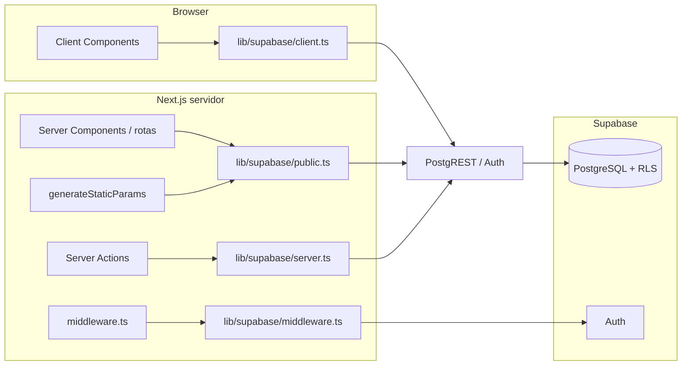

# Estrutura do Projeto

## Visão geral da arquitetura

Via Fidei é um app **Next.js 15 (App Router)** com dados em **Supabase** (PostgreSQL + Auth + RLS). Não há backend próprio fora do que o Next expõe (Server Components, Server Actions) e a API REST do Supabase.

- **Páginas públicas** (home, `/igreja/[slug]`, `/clero`): leitura via **`createPublicClient()`** — sem `cookies()`, compatível com build estático e RLS como role `anon`.
- **Área autenticada** (`/login`, `/admin`, Server Actions): **`createServerClient()`** com cookies — JWT do usuário nas políticas RLS.
- **Interação no cliente** (AuthProvider, formulários admin que usam cliente): **`createBrowserClient()`** — mesma URL e chave pública do projeto.

---

## Stack e dados (Supabase)

Resumo do que está em produção hoje:

| Camada | Descrição |
|--------|-----------|
| **Banco** | PostgreSQL no Supabase; schema versionado em [`supabase/migrations/`](supabase/migrations/) (`001`–`009`). Aplicar em ordem no **SQL Editor** do projeto (ou `supabase db push` com CLI linkado). Como as migrations foram aplicadas pelo SQL Editor, o histórico de migrations do projeto remoto está vazio — conferir o estado pelo schema, não por `supabase migration list`. |
| **Chaves públicas** | URL + chave **publishable** ou **anon** (JWT) para o cliente. Resolução central em [`lib/supabase/env.ts`](lib/supabase/env.ts) — ver subseção **Variáveis de ambiente (Supabase + Vercel)** abaixo. `SUPABASE_SERVICE_ROLE_KEY` **apenas** servidor / `npm run seed` ([API keys](https://supabase.com/docs/guides/api/api-keys)). |
| **Auth** | Supabase Auth + cookies (`@supabase/ssr`); [`middleware.ts`](middleware.ts) na raiz renova a sessão; [`features/auth/`](features/auth/) expõe `AuthProvider` e `useAuth`. |
| **Leitura pública** | [`lib/supabase/public.ts`](lib/supabase/public.ts) — `createClient` do `@supabase/supabase-js` só com chave pública, **sem** `cookies()`. Usado em [`lib/supabase/queries/`](lib/supabase/queries/) (listagens, detalhes, `generateStaticParams`). |
| **Sessão no servidor** | [`lib/supabase/server.ts`](lib/supabase/server.ts) — `createServerClient` com cookies (login, `/admin`, Server Actions). |
| **Cliente browser** | [`lib/supabase/client.ts`](lib/supabase/client.ts) — `createBrowserClient` (`@supabase/ssr`). |
| **Middleware** | [`lib/supabase/middleware.ts`](lib/supabase/middleware.ts) — usado pelo [`middleware.ts`](middleware.ts) na raiz (refresh de sessão). |
| **Service role** | [`lib/supabase/service-role.ts`](lib/supabase/service-role.ts) — `createServiceRoleClient()` (sem sessão persistida), **somente servidor**. Usado pela Server Action `createEditor` para a Auth Admin API (`auth.admin.createUser`), que não aceita a chave pública. |
| **Seed** | [`scripts/seed.ts`](scripts/seed.ts) + [`scripts/load-env.ts`](scripts/load-env.ts) — `npm run seed` popula o banco a partir de `data/*.ts` (requer `SUPABASE_SERVICE_ROLE_KEY` + URL resolvível por `getSupabaseUrl()`). |
| **Bootstrap de usuários** | [`scripts/bootstrap-users.ts`](scripts/bootstrap-users.ts) — `npm run bootstrap-users` cria (ou reaproveita) um admin e um editor de teste no Auth, ajusta `profiles.role` e vincula o editor a uma igreja em `editor_churches`. Variáveis `ADMIN_*` / `EDITOR_*` documentadas em [`.env.example`](.env.example). |
| **Dados em TS** | Arquivos em [`data/`](data/) não são importados pelas páginas; servem de fonte para o seed e referência. |

**ISR:** `export const revalidate = 60` nas páginas que listam dados do Supabase.

### Variáveis de ambiente (Supabase + Vercel)

O Next.js só injeta no **bundle do browser** variáveis com prefixo `NEXT_PUBLIC_*`. A **integração oficial Vercel ↔ Supabase** costuma criar também `SUPABASE_URL`, `SUPABASE_ANON_KEY`, `SUPABASE_PUBLISHABLE_KEY` (sem esse prefixo).

| Necessidade | Variáveis aceitas (ordem de preferência) |
|-------------|------------------------------------------|
| URL do projeto | `NEXT_PUBLIC_SUPABASE_URL` → fallback `SUPABASE_URL` |
| Chave pública (API) | `NEXT_PUBLIC_SUPABASE_PUBLISHABLE_KEY` → `NEXT_PUBLIC_SUPABASE_ANON_KEY` → `SUPABASE_PUBLISHABLE_KEY` → `SUPABASE_ANON_KEY` |
| Privilegiada (seed, bootstrap, Auth Admin API, bypass RLS) | `SUPABASE_SERVICE_ROLE_KEY` (nunca `NEXT_PUBLIC_`). Necessária também em runtime no servidor para criar editores pelo painel `/admin/usuarios/novo`. |
| Bootstrap de usuários (opcional, só local) | `ADMIN_EMAIL`, `ADMIN_PASSWORD`, `EDITOR_EMAIL`, `EDITOR_PASSWORD`, `ADMIN_NAME`, `EDITOR_NAME`, `EDITOR_CHURCH_ID` |

[`next.config.ts`](next.config.ts) espelha no build os valores `SUPABASE_*` para `NEXT_PUBLIC_*` quando só a integração preenche os nomes sem prefixo — assim **`createBrowserClient`** e o restante do código continuam funcionando no cliente.

**Deploy na Vercel:** marque as variáveis para **Production** e **Preview** (deploys de PR). Se estiverem só em Production, o build de Preview falha por ausência de URL/chave no ambiente.

**Local:** copie [`.env.example`](.env.example) para `.env.local`. O `.env.local` não é enviado ao Git; na Vercel as variáveis vêm do painel ou da integração.

### Integração com o código

| Arquivo | Papel |
|---------|--------|
| [`lib/supabase/env.ts`](lib/supabase/env.ts) | `getSupabaseUrl()`, `getSupabasePublishableKey()`, `getSupabaseServiceRoleKey()`, `isSupabasePublicConfigured()` |
| [`lib/supabase/public.ts`](lib/supabase/public.ts) | Cliente anônimo para queries públicas (sem sessão) |
| [`lib/supabase/server.ts`](lib/supabase/server.ts) | Cliente com cookies (sessão) |
| [`lib/supabase/client.ts`](lib/supabase/client.ts) | Cliente no browser |
| [`lib/supabase/service-role.ts`](lib/supabase/service-role.ts) | Cliente privilegiado (service role) — só servidor |
| [`lib/supabase/queries/churches.ts`](lib/supabase/queries/churches.ts) | `getChurches`, `getChurchBySlug`, `getChurchSlugs` |
| [`lib/supabase/queries/clergy.ts`](lib/supabase/queries/clergy.ts) | `getAllClergyWithChurch` |
| [`supabase/migrations/*.sql`](supabase/migrations/) | Schema + RLS (`008_rls_policies.sql`) |

---

## Organização por Feature

O projeto segue uma arquitetura organizada por **features/domínios**, não por tipo de arquivo.

### Raiz do repositório

- [`middleware.ts`](middleware.ts) — integração `@supabase/ssr` para refresh de sessão (matcher exclui assets estáticos)

### `/app` - App Router (Next.js)

Contém rotas, layouts e páginas da aplicação.

- `layout.tsx` - Layout raiz com metadados, fontes e AuthProvider
- `page.tsx` - Página inicial (listagem de igrejas com busca e filtro)
- `globals.css` - Estilos globais e variáveis CSS do Tailwind
- `igreja/[slug]/page.tsx` - Página de detalhes da igreja (SSR com `generateStaticParams`)
- `igreja/[slug]/not-found.tsx` - Página 404 customizada
- `clero/page.tsx` - Listagem geral de clérigos com filtro alfabético
- `login/page.tsx` - Página de login (rota escondida, sem link na UI)
- `admin/layout.tsx` - Layout admin com verificação de papel (sem sessão → `/login`; não admin → `/`) e `AdminHeader`
- `admin/page.tsx` - Dashboard admin com estatísticas (igrejas, editores, clérigos)
- `admin/usuarios/` - Lista, detalhe (ativar/desativar, vínculos com igrejas) e criação de editores

### `/features` - Features do domínio

Cada feature agrupa componentes, hooks e lógica relacionados.

**`/features/churches`** - Feature de igrejas

- `church-card.tsx` - Card de igreja para listagem
- `church-list.tsx` - Lista de igrejas com busca e filtros (Client Component)
- `use-church-filters.ts` - Hook de busca, filtro por bairro e paginação
- `page-header.tsx` - Header da página inicial
- `pagination.tsx` - Componente de paginação
- `pagination-controls.tsx` - Controles de paginação
- `per-page-filter.tsx` - Filtro de itens por página

**`/features/churches/schedule`** - Horários das igrejas

- `schedule-tabs.tsx` - Componente de abas (Client Component)
- `schedule-day-list.tsx` - Lista de horários por dia em accordion (shadcn/ui Accordion). Cada dia é um item colapsável com contagem de horários; o primeiro dia vem expandido por padrão. **Layout anterior**: lista vertical simples com todos os dias empilhados (`space-y-4`) e badges de horário em `flex-wrap` -- sem colapsável, todo conteúdo visível de uma vez.
- `schedule-empty.tsx` - Estado vazio
- `activity-list.tsx` - Lista de atividades

**`/features/churches/clergy`** - Clero das igrejas

- `clergy-card.tsx` - Card básico de clérigo
- `clergy-card-with-modal.tsx` - Card com modal de detalhes
- `clergy-detail-modal.tsx` - Modal com informações detalhadas do clérigo
- `clergy-list.tsx` - Lista de clérigos ativos da paróquia
- `clergy-history.tsx` - Histórico de clérigos anteriores

**`/features/churches/contact`** - Contato das igrejas

- `church-contact-section.tsx` - Seção de contato (telefone, WhatsApp, redes sociais)

**`/features/churches/ministries`** - Grupos, movimentos e pastorais

- `ministries-section.tsx` - Seção principal com subdivisões por categoria (Grupos, Movimentos, Pastorais)
- `ministry-list.tsx` - Lista de ministérios renderizados como tags/badges

**`/features/clergy`** - Feature de listagem de clérigos (página `/clero`)

- `clergy-page-list.tsx` - Lista com busca e filtro alfabético (Client Component)
- `clergy-list-card.tsx` - Card compacto de clérigo
- `clergy-page-modal.tsx` - Modal com detalhes e link para paróquia
- `use-clergy-filters.ts` - Hook de busca e filtro por letra inicial

**`/features/churches/editor`** - Experiência de edição na página de igreja

- `editable-section.tsx` - Wrapper que exibe empty state + botão "Adicionar" para editores vinculados
- `edit-indicator.tsx` - Ícone de lápis exibido condicionalmente para quem pode editar
- `admin-church-link.tsx` - Link para gerenciar editores (visível apenas para admin)

**`/features/auth`** - Autenticação e controle de acesso

- `auth-provider.tsx` - Provider com estado do usuário, papel e igrejas vinculadas
- `use-auth.ts` - Hook para acessar contexto de autenticação
- `actions.ts` - Server Actions de login/logout
- `admin-actions.ts` - Server Actions para gestão de editores (admin)
- `types.ts` - Tipos (UserRole, UserProfile, AuthContextValue)

**`/features/admin`** - Área administrativa

- `admin-header.tsx` - Header do painel `/admin` (mesmo padrão do header público: logo, navegação com ícones, link ativo destacado e botão de tema). No mobile mostra só os ícones (textos em `sr-only`); a partir de `md` mostra os textos.

**`/features/theme`** - Tema da aplicação

- `theme-provider.tsx` - Provider de tema claro/escuro
- `theme-toggle.tsx` - Botão de alternância de tema

### `/components` - Componentes compartilhados

Componentes reutilizáveis em todo o projeto.

**`/components/ui`** - Componentes do shadcn/ui

- Instalados via `npx shadcn@latest add [component]`
- Customizáveis e prontos para uso

### `/lib` - Bibliotecas e utilitários

Código auxiliar reutilizável.

**`/lib/utils`** - Funções utilitárias

- `cn.ts` - Função para merge de classes Tailwind
- `slugify.ts` - Geração de slugs a partir de nomes
- `schedule.ts` - Utilitários de horários:
  - `formatTime()` - Formata hora ("18:00" → "18h")
  - `formatTimeRange()` - Formata intervalo ("06:30" - "17:30")
  - `getDayName()` / `getDayNameShort()` - Nome do dia em português
  - `groupByDay()` - Agrupa eventos por dia da semana
  - `getOrderedDays()` - Dias ordenados (domingo primeiro)
  - `canGroupWeekdays()` - Verifica se pode agrupar dias úteis
  - `formatRecurrence()` - Label de recorrência ("1ª Sexta-feira do mês")
  - `isValidTime()` - Valida formato HH:MM
  - `getEventKey()` - Gera chave única para React
- `clergy.ts` - Utilitários de clero:
  - `getRoleLabel()` - Traduz role para português ("Pároco", "Vigário")
  - `getClergyTitle()` - Retorna prefixo ("Pe.", "Mons.", "Fr.", "Dom")
  - `formatClergyName()` - Nome completo formatado ("Pe. José da Silva, OFM")
  - `sortClergyByRole()` - Ordena por hierarquia canônica
  - `isActiveClergyMember()` / `getActiveClergyMembers()` - Filtra clérigos ativos
  - `getPastClergyMembers()` - Filtra clérigos anteriores
  - `formatClergyTenure()` - Período de atuação ("2021 - Atual")
  - `sortClergyByStartDate()` - Ordena por data de início
  - `getClergyForChurch()` - Filtra clérigos de uma igreja específica por churchId
  - `getAllClergyWithChurch()` - Enriquece clérigos com dados da igreja (join por churchId)
  - `sortClergyByName()` - Ordena alfabeticamente por nome
  - `getClergyInitials()` - Letras iniciais únicas dos nomes
  - `filterClergyByInitial()` - Filtra por letra inicial (ignora acentos)
- `contact.ts` - Utilitários de contato:
  - `formatPhoneForDisplay()` - Formata telefone ("(82) 99999-9999")
  - `formatPhoneForHref()` - Telefone para href (apenas dígitos)
  - `formatInstagramHandle()` / `getInstagramUrl()` - Instagram
  - `formatFacebookName()` / `getFacebookUrl()` - Facebook
  - `getWebsiteUrl()` / `formatWebsiteForDisplay()` - Website

### `/types` - Definições de tipos TypeScript

Tipos e interfaces compartilhados.

- `church.ts` - Tipos principais:
  - `Church` - Interface da igreja
  - `ChurchType` - Tipo de entidade ("parish", "rectory", "cathedral", "chapel", "sanctuary")
  - `ChurchContact` - Informações de contato
  - `ScheduleEvent` - Evento de horário (missa, adoração, confissão)
  - `Activity` - Atividade com horários
  - `DayOfWeek` - Tipo literal (0-6)
  - `RecurrenceType` - Tipos de recorrência
  - `Clergy` - Interface do clérigo
  - `ClergyWithChurch` - Clérigo enriquecido com dados da igreja (para listagens)
  - `ClergyRole` - Cargo ("parish-priest", "vicar", "deacon", "administrator", "rector")
  - `ClergyTitle` - Título ("padre", "monsenhor", "frei", "dom")
  - `ReligiousOrderSuffix` - Ordem religiosa ("OFM", "SJ", "OP", "OSB", etc.)
  - `ChurchMinistry` - Grupo, movimento ou pastoral (`{ id, label, acronym? }`)
  - `ChurchMinistries` - Ministérios por categoria (`{ groups?, movements?, pastorals? }`)
- `index.ts` - Re-exporta todos os tipos

### `/data` - Dados estáticos (legado)

Arquivos TS mantidos como referência e para o script de seed (`scripts/seed.ts`). **Não são mais importados** pelas páginas da aplicação — os dados vêm do Supabase.

- `churches.ts` - 55 igrejas reais de Maceió/AL (fonte: [Hora da Missa](https://www.horadamissa.com))
- `clergy.ts` - Clérigos como entidades independentes
- `ministries.ts` - Grupos, movimentos e pastorais por categoria

### `/public` - Assets estáticos

Arquivos públicos servidos diretamente.

**`/public/images`** - Imagens (estrutura flat)

- `via-fidei-logo.png` - Logo e imagem padrão (placeholder)
- Imagens de igrejas e clérigos por slug (ex: `sao-paulo-apostolo.jpg`, `pe-manoel-jose-dos-santos.jpg`)

### `/lib/supabase` - Integração com Supabase

Papel de cada arquivo, variáveis e fallbacks da integração Vercel: ver as seções **Stack e dados (Supabase)** e **Integração com o código** no início deste documento.

### `/supabase` - Migrations SQL

Arquivos de migration para criar o schema do banco, ordenados numericamente:

- `001_profiles.sql` - Tabela de perfis (vinculada ao auth.users) + triggers
- `002_churches.sql` - Tabela de igrejas
- `003_schedule_events.sql` - Horários (missas, adorações, confissões)
- `004_activities.sql` - Atividades + horários de atividades
- `005_clergy.sql` - Clérigos + vínculo clérigo-igreja
- `006_ministries.sql` - Ministérios + vínculo ministério-igreja
- `007_editor_churches.sql` - Vínculo editor-igreja
- `008_rls_policies.sql` - Todas as políticas de Row Level Security
- `009_profiles_auth_insert_policies.sql` - Reescreve `handle_new_user()` com `search_path` explícito (corrige "Database error creating new user") e adiciona políticas de INSERT em `profiles` (ver pendência de segurança em **Próximos Passos**)

### `/scripts`

- `seed.ts` - Migra dados de `data/*.ts` para o Supabase (usa `SUPABASE_SERVICE_ROLE_KEY`)
- `bootstrap-users.ts` - Cria/reaproveita admin + editor de teste e vincula o editor a uma igreja (`npm run bootstrap-users`)
- `load-env.ts` - Carrega `.env.local` antes dos scripts (via `dotenv`)

## Fluxo de dados

1. Dados no **Supabase** (PostgreSQL); acesso controlado por **RLS** (políticas em `008_rls_policies.sql`).
2. **Variáveis** carregadas em build/runtime conforme [`lib/supabase/env.ts`](lib/supabase/env.ts); [`next.config.ts`](next.config.ts) replica `SUPABASE_*` → `NEXT_PUBLIC_*` para o bundle do browser quando necessário.
3. **Leituras públicas** (home, detalhe da igreja, clero): `lib/supabase/public.ts` + `queries/*` — sem `cookies()`, role `anon` nas políticas. `generateStaticParams` em `/igreja/[slug]` usa o mesmo cliente público.
4. **Sessão autenticada**: `lib/supabase/server.ts` (cookies) — login, `/admin`, Server Actions; **`middleware.ts`** na raiz renova tokens antes das rotas.
5. **ISR** com `revalidate = 60` nas páginas que consomem Supabase.
6. **UI com estado local**: `features/churches` com busca/filtro/paginação em `useState` após hidratação (dados já vindos do servidor).

## Convenções de código

- **Componentes**: PascalCase (`ChurchCard.tsx`)
- **Utilitários**: camelCase (`cn.ts`, `slugify.ts`)
- **Tipos**: PascalCase (`Church`, `ChurchFilters`)
- **Pastas**: kebab-case (`features/churches`)

## Boas práticas

- Preferir **Server Components** por padrão
- **Client Components** apenas quando necessário (interatividade)
- Props + composição ao invés de Context API
- Mobile-first (Tailwind)
- Tipagem forte desde o início
- Chaves React estáveis (não usar índice de array)
- Validação de dados de entrada (ex: formato de hora)

## Próximos Passos

### Estado atual e pendências (atualizado em 23/10/2026)

Validado ponta a ponta com Playwright (fluxos públicos, admin e editor) em 23/10/2026. Detalhes dos casos em [docs/QA.md](docs/QA.md).

**Concluído**

- [x] Dados públicos servidos pelo Supabase (home, `/igreja/[slug]`, `/clero`) com ISR
- [x] Login em `/login` com redirecionamento por papel; proteção de `/admin/*` no layout
- [x] Painel admin: dashboard, lista, detalhe (ativar/desativar, vínculos) e criação de editores
- [x] `createEditor` usando cliente service role para a Auth Admin API (criação validada pelo painel)
- [x] `npm run bootstrap-users` para criar o admin e um editor de teste
- [x] Migration `009`: trigger `handle_new_user()` com `search_path` explícito
- [x] Página da igreja condicionada ao papel: admin vê "Gerenciar editores", lápis e empty states com "Adicionar"; editor vê lápis só nas igrejas vinculadas
- [x] Telas `/admin/*` responsivas (mobile, tablet e desktop) no padrão visual do site público

**Pendente — segurança (prioridade alta)**

- [ ] **Escalada de privilégio em `profiles`:** a política `profiles_update_own` (`008`) deixa qualquer usuário autenticado alterar a própria linha sem restrição de coluna; um editor pode mudar o próprio `role` para `admin` ou se reativar via API. Corrigir com trigger `BEFORE UPDATE` que só permite alterar `role`/`is_active` quando `is_admin()` (ou quando a chamada não vem da role `authenticated`, para manter scripts com service role).
- [ ] **Revisar a migration `009`:** o trigger pertence ao `postgres` (dono da tabela, sem `FORCE RLS`), então já ignorava o RLS — a correção real foi o `search_path`. As políticas `profiles_insert_service_role` (service role já ignora RLS) e `profiles_insert_supabase_auth_admin` são desnecessárias, e `profiles_insert_self` permite que um usuário sem perfil insira a própria linha com qualquer `role`. Remover as três numa migration `010`.
- [ ] Confirmar no Supabase (Authentication → Providers) se o cadastro público está desativado; o app não tem tela de cadastro.
- [ ] Checagem de papel admin em `toggleEditorActive` e `updateEditorChurches` (hoje dependem só do RLS; `createEditor` já checa).
- [ ] `import "server-only"` em `lib/supabase/service-role.ts` para impedir uso acidental em Client Components.

**Pendente — funcional**

- [ ] Botão de sair e indicador de sessão: a action `logout` existe em `features/auth/actions.ts`, mas nenhuma tela a usa.
- [ ] Formulários e Server Actions de edição para editor/admin na página da igreja (botões "Adicionar" e lápis ainda sem fluxo).
- [ ] `createEditor`: desfazer a criação do usuário no Auth se a atualização do perfil ou o vínculo de igrejas falhar (hoje fica um usuário órfão).
- [ ] `updateEditorChurches`: apagar e reinserir vínculos não é atômico; se a inserção falhar, o editor perde todos os vínculos.
- [ ] Seção vazia para visitante: hoje o card e o título aparecem sem conteúdo (`EditableSection` retorna `null` só para o corpo). Decidir entre ocultar a seção inteira (alvo de UX abaixo) ou exibir a mensagem de vazio (o que o QA CT-007 espera).

**Pendente — qualidade e dados**

- [ ] Detalhe do editor (`/admin/usuarios/[id]`): rodar as 3 consultas da página em paralelo (`Promise.all`); hoje são sequenciais (1–2 s por carregamento).
- [ ] Metadata das telas admin (título genérico "Via Fidei") e `robots: noindex` para `/admin` e `/login`.
- [ ] Avisos do Next.js no console: `metadataBase` não definido; imagem do logo detectada como LCP sem `priority`.
- [ ] Dados: só 2 clérigos cadastrados (ambos de São Paulo Apóstolo); contato de São Paulo Apóstolo com valores de exemplo (`(82) 99999-9999`). Conferir o seed.

### Dados e entidades

#### Cadastro e manutenção de dados

Os dados de produção vivem no **Supabase**. Para enriquecer igrejas e clérigos: **Table Editor**, SQL ou fluxos futuros de edição (admin/editor). O seed inicial partiu de `data/*.ts`; alterações pontuais podem continuar atualizando os TS e rodando `npm run seed` em ambiente de desenvolvimento (ou editar direto no banco).

#### Histórico do clero nas igrejas

Novo campo `clergyHistory?: Clergy[]` na interface `Church` (separado de `clergy[]`) para armazenar clérigos que já passaram pela paróquia. `clergyHistory[]` **substitui** a lógica atual de filtrar por `endDate` em `clergy[]`. No banco, alinhar com `church_clergy` (datas) ou coluna dedicada. O componente `ClergyHistory` passaria a consumir esse campo em vez de filtrar `church.clergy`. Sessão dedicada na página de detalhes da igreja.

### Contribuição do usuário

#### Sugestão de correção/contribuição

Botão discreto na página de detalhes da igreja e no modal de detalhes do clérigo com texto semelhante a "Algum dado errado ou deseja contribuir com outras informações? Clique aqui". Modal com formulário contendo: referência da igreja/clérigo (preenchida automaticamente), assunto, descrição e email de contato. Inicialmente sem backend: `console.log` dos dados + toast de confirmação para verificação.

#### Sugestão de cadastro

Botão abaixo do filtro na listagem de igrejas ("Não encontrou a igreja que queria?") e na listagem de clérigos ("Não encontrou o padre que queria?"). Modal com formulário contendo campos da entidade correspondente (com tipos corretos). Campos mínimos obrigatórios para submissão (ex: nome e bairro para igreja, nome e função para clérigo). Inicialmente sem backend: `console.log` dos dados + toast de confirmação para verificação.

### Área administrativa e controle de acesso

#### Modelo de papéis

Três papéis no sistema:

| Papel | Acesso | Capacidades |
|-------|--------|-------------|
| **Admin** | Rota `/admin` + todas as igrejas | Criar/gerenciar editores, vincular a igrejas, editar dados de qualquer igreja, cadastrar entidades |
| **Editor de Igreja** | Login + igrejas vinculadas | Navegar normalmente; editar/adicionar dados apenas nas igrejas vinculadas à sua conta |
| **Visitante** | Público (anônimo) | Navegar, consultar dados, sugerir correções (futuro) |

Um editor pode ser vinculado a **múltiplas igrejas**. Admin tem acesso de edição em todas.

#### Autenticação (implementado)

- **Login:** `/login` (rota sem link na UI). Email/senha via Supabase Auth (`signInWithPassword`); redirecionamento: admin → `/admin`, editor → `/`.
- **Sessão:** cookies + `@supabase/ssr`; `middleware.ts` na raiz renova tokens; `AuthProvider` + `useAuth` no cliente para papel e igrejas vinculadas.
- **Perfis:** tabela `profiles` (roles `admin` | `editor`, padrão `editor`), trigger `handle_new_user()` ao criar usuário em `auth.users`.
- **Primeiro admin:** `npm run bootstrap-users` (ou criar no Dashboard e `update profiles set role = 'admin'` no SQL Editor).
- **Logout:** action `logout` implementada, **sem botão na UI** (pendente).

#### Gestão de editores (admin) — implementado

- Dashboard `/admin`, lista `/admin/usuarios`, detalhe `/admin/usuarios/[id]`, novo `/admin/usuarios/novo`.
- Criação de editor pelo painel usa `createServiceRoleClient()` para `auth.admin.createUser` (email já confirmado) e vincula as igrejas selecionadas.
- Vincular/desvincular igrejas, ativar/desativar editor. Atalho **Gerenciar editores** na página da igreja para admin (`AdminChurchLink`).
- Layout responsivo com `AdminHeader` (`features/admin`): grids de 1 coluna no mobile, 3 no dashboard a partir de `sm` e 2/3 na lista de editores (`md`/`xl`).

#### Experiência do editor na página de igreja — UI preparada

- Componentes `EditableSection`, `EditIndicator`, `admin-church-link` condicionam empty state + lápis ao papel e vínculos.
- **Pendente:** formulários e Server Actions que persistem alterações no Supabase (botões de adicionar/editar ainda sem fluxo completo).

#### Comportamento por papel na página de detalhes (alvo de UX)

| Seção | Visitante | Editor (vinculado) | Admin |
|-------|-----------|-------------------|-------|
| Dados preenchidos | Visualiza | Visualiza + lápis para editar | Visualiza + lápis para editar |
| Seção vazia | Oculta (**hoje:** card e título aparecem sem conteúdo) | Empty state + botão "Adicionar" | Empty state + botão "Adicionar" |
| Igreja não vinculada | — | Visualiza (somente leitura, igual ao visitante) | — |

#### Cadastros administrativos — pendências

- **Igrejas / clérigos / ministérios em massa:** telas com formulário ou JSON validado contra os tipos — **não implementadas**; dados entram hoje via seed, SQL ou Table Editor.
- **Editores:** criação via `admin-actions` com cliente service role — validada pelo painel em 23/10/2026 (ambiente local apontando para o projeto Supabase). Na Vercel, `SUPABASE_SERVICE_ROLE_KEY` precisa estar definida (Production e Preview) para o formulário funcionar.

### Infraestrutura

#### Migração de imagens para cloud (V2)

Atualmente as imagens ficam em `/public/images/`. Em V2, considerar migração para storage em nuvem (Vercel Blob, Supabase Storage, Cloudinary).
